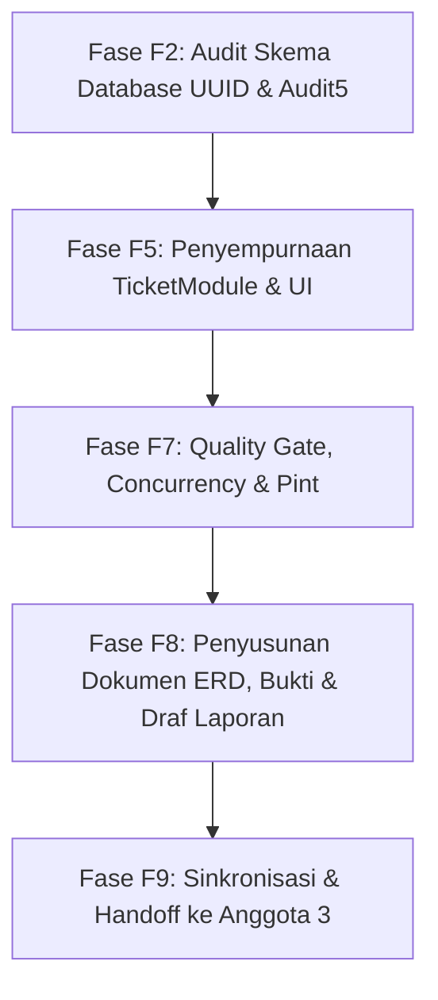

# PANDUAN PENGERJAAN ANGGOTA 2
## TicketModule + Koordinator Skema & Database — Sistem Manajemen Event & Tiket

**Identitas Penanggung Jawab:** Anggota 2 (B) — Muhammad Imam Panji Prasetya (`panjiprasetyaa`)  
**Acuan Resmi:** `ROADMAP_DAN_DOKUMENTASI_UTS_BACKEND_EVENT_TIKET_V4_ROADMAP_TIM.md` (Bagian J, J0, J1)  
**Tanggung Jawab Modul:** `app/Modules/TicketModule/**` dan Seluruh Skema Database Aplikasi  
**Tanggung Jawab Laporan:** **BAB II (ERD & Data Dictionary)** dan **BAB III (Implementasi Database & TicketModule)**  
**Tanggal Penyusunan:** 17 November 2026

---

## 0. RINGKASAN PERAN DAN POSISI ANGGOTA 2

Anggota 2 bertindak sebagai **Database Architect & Inventory Engineer**:
1. Mengawal konsistensi skema 8 tabel aplikasi berbasis **UUID dan 5 kolom audit (`[AUDIT5]`)**.
2. Memiliki dan memelihara seluruh logika `TicketModule`:
   - Validasi data tiket melalui Form Request (`StoreTicketRequest`, `UpdateTicketRequest`).
   - Manajemen harga integer rupiah (`price_rupiah`), kuota awal, sisa kuota, dan jendela periode penjualan (`sales_start`, `sales_end`).
   - Interface `TicketInventoryContract` dan implementasi `TicketInventoryService`.
   - Mekanisme penguncian baris deterministik (`lockForUpdate()`) di dalam transaksi database.
   - Penanganan Custom Exception: `TicketQuotaExceededException` dan `TicketNotAvailableException`.
   - Pembaruan audit trail stamping: `tickets.updated_by = Auth::id()` saat kuota berkurang.
3. Menyusun dokumen perancangan database formal untuk Laporan UTS:
   - Data Dictionary lengkap 8 tabel aplikasi.
   - Entity Relationship Diagram (ERD) standar Crow's Foot.
4. Mengumpulkan screenshot bukti pengujian ke folder `docs/evidence/02-database/` dan `docs/evidence/05-ticket/`.

> [!IMPORTANT]
> **Batasan Tegas Antar-Anggota:**
> - Anggota 1 telah menyelesaikan F0–F4 (`EventModule`, Auth Sanctum, RBAC).
> - Anggota 3 bertanggung jawab atas antarmuka checkout frontend, riwayat e-ticket peserta, pengujian integrasi rollback multi-item di BAB IV, serta rekaman/editing Video Demo.
> - **Anggota 2 fokus 100% pada TicketModule, Database/ERD, dan bahan laporan BAB II & III.**

---

## 1. DEFINISI SELESAI (DEFINITION OF DONE) ANGGOTA 2

Pekerjaan Anggota 2 dinyatakan **Selesai (Done)** apabila:
- [x] Branch kerja `feat/anggota-2-ticket-and-database` aktif dan commit menggunakan identitas author `panjiprasetya`.
- [x] Dokumen operasional `PANDUAN_PENGERJAAN_ANGGOTA_2.md` dan `CHECKLIST_ANGGOTA_2.md` tersedia di root proyek.
- [x] Dokumen `docs/DATA_DICTIONARY_DAN_ERD.md` tersusun rapi dengan diagram Mermaid ERD dan tabel kamus data lengkap.
- [x] Tampilan antarmuka Blade admin tiket (`index.blade.php`, `_form.blade.php`) menerapkan prinsip anti-slop, WCAG AA, dan tactile feedback.
- [x] Seluruh unit dan feature test `TicketModule` lulus 100% (`TicketAdminTest`, `TicketInventoryTest`).
- [x] Kode diformat rapi sesuai standar Laravel Pint (`./vendor/bin/pint --test` lulus).
- [x] Panduan screenshot bukti untuk `docs/evidence/02-database/` dan `docs/evidence/05-ticket/` siap digunakan.
- [x] Draf laporan UTS BAB II (ERD) dan BAB III (Database/Tiket) tersusun di `docs/DRAF_LAPORAN_BAB2_BAB3_ANGGOTA_2.md`.

---

## 2. PETA FASE KERJA ANGGOTA 2 (F2, F5, F7, F8, F9)



### 2.1 Fase F2: Koordinator Skema & Database
- Memverifikasi 8 tabel aplikasi menggunakan UUID sebagai primary key:
  `users`, `categories`, `events`, `tickets`, `registrations`, `registration_tickets`, `issued_tickets`, dan `event_tag` (opsional).
- Memastikan 5 kolom audit (`[AUDIT5]`): `id` (UUID PK), `created_at`, `created_by` (UUID FK), `updated_at`, `updated_by` (UUID FK) hadir di seluruh tabel bisnis.
- Memastikan relasi One-to-Many (`Category` $\rightarrow$ `Event`, `Event` $\rightarrow$ `Ticket`) dan Many-to-Many (`Registration` $\leftrightarrow$ `Ticket` via pivot `registration_tickets`) berfungsi sempurna di level database.

### 2.2 Fase F5: Pemilik Logika & Antarmuka TicketModule
- Mengawal antarmuka web CRUD tiket admin (`/admin/tickets`):
  - Form penambahan tiket dengan validasi event, nama, kuota awal, harga rupiah, status aktif/nonaktif, dan rentang tanggal penjualan.
  - Form edit tiket yang menjaga kuota agar tidak diedit lebih rendah dari tiket yang telah terjual (`initial_quota >= sold_count`).
- Memastikan kontrak `TicketInventoryContract` menyediakan pemisahan data murni (array primitive/DTO) dan tidak mengembalikan model Eloquent ke modul lain:
  - `getSummary(string $ticketId): ?array`
  - `getEventTickets(string $eventId): array`
  - `reserve(string $ticketId, int $quantity): array` (wajib di dalam `DB::transaction()` dengan `lockForUpdate()`)
  - `release(string $ticketId, int $quantity): void`

### 2.3 Fase F7: Quality Gate & Concurrency Audit
- Menjalankan test suite:
  ```powershell
  php artisan test tests/Feature/TicketModule
  ```
- Menjalankan Laravel Pint:
  ```powershell
  ./vendor/bin/pint --test
  ```
- Memastikan tidak ada pelanggaran boundary modul: modul `RegistrationModule` dilarang memanggil `Ticket::query()` secara langsung, melainkan harus selalu lewat `TicketInventoryContract`.

### 2.4 Fase F8: Dokumentasi & Bukti Laporan
- Menghasilkan diagram ERD Crow's Foot dan kamus data di `docs/DATA_DICTIONARY_DAN_ERD.md`.
- Mengisi panduan screenshot bukti di:
  - `docs/evidence/02-database/README.md`
  - `docs/evidence/05-ticket/README.md`
- Menyusun teks draf Laporan UTS untuk BAB II dan BAB III di `docs/DRAF_LAPORAN_BAB2_BAB3_ANGGOTA_2.md`.

### 2.5 Fase F9: Presentasi Video Demo (Materi Database & Tiket)
- Bagian Anggota 2 dalam storyboard video demo (menit 02:00 – 03:20):
  - Memperlihatkan struktur tabel database di GUI database/terminal.
  - Menjelaskan relasi One-to-Many dan Many-to-Many tabel pivot `registration_tickets`.
  - Menjelaskan interface `TicketInventoryContract` dan metode pemotongan stok atomik `reserve()`.

---

## 3. CHECKLIST HANDOFF DENGAN ANGGOTA LAIN

1. **Handoff dari Anggota 1 (A) ke Anggota 2 (B):**
   - Anggota 1 telah menyelesaikan `EventModule` dan menyediakan `EventInfoContract`.
   - Anggota 2 menggunakan `EventInfoContract::getEventOptions()` untuk dropdown pilihan event pada form tiket.
2. **Handoff dari Anggota 2 (B) ke Anggota 3 (C):**
   - Anggota 2 menjamin `TicketInventoryContract::reserve()` dan `TicketQuotaExceededException` sudah stabil dan teruji.
   - Anggota 3 dapat langsung menggunakan kontrak tersebut di dalam `CheckoutService` milik `RegistrationModule`.
