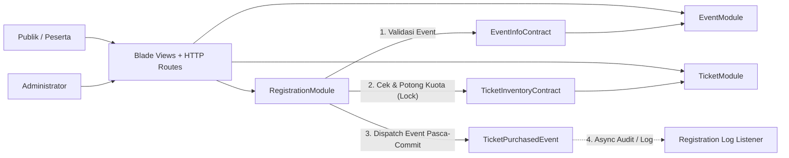

# Sistem Manajemen Event & Tiket

Aplikasi web manajemen kegiatan dan transaksi penjualan tiket berbasis **Laravel 13**, **PHP 8.4+**, **Blade Templates**, dan **Laravel Sanctum**. Dibangun menggunakan arsitektur **Modular Monolith** dengan pemisahan batas domain yang tegas antara `EventModule`, `TicketModule`, dan `RegistrationModule`.

Proyek ini disusun sebagai pemenuhan Ujian Tengah Semester (UTS) mata kuliah **Backend Development (DT199)**, Program Studi D3-Teknik Informatika, Fakultas Ilmu Komputer, Universitas Amikom Yogyakarta.

---

## 1. Arsitektur Sistem: Modular Monolith

Aplikasi menerapkan pola Modular Monolith di mana setiap modul berada di dalam direktori `app/Modules/` dengan Service Provider mandiri yang didaftarkan pada `bootstrap/providers.php`.



### Prinsip Batas Modul (Boundary Discipline)
* **Zero Cross-Module Direct Model Access:** Modul `RegistrationModule` tidak diperbolehkan meng-import atau melakukan query langsung ke model `Ticket` maupun `Event`. Seluruh komunikasi data antar-modul wajib melewati antarmuka **Contract (Interface)** yang mengembalikan array/DTO primitif.
* **Service Provider Mandiri:** Setiap modul memuat migrasi (`loadMigrationsFrom`), rute (`loadRoutesFrom`), dan view (`loadViewsFrom`) masing-masing.
* **Isolasi Domain Event:** Event pemesanan (`TicketPurchasedEvent`) menerapkan `ShouldDispatchAfterCommit` agar efek samping hanya terjadi setelah transaksi database benar-benar berhasil di-*commit*.

---

## 2. Fitur Utama

* **Role-Based Access Control (RBAC):** Pemisahan hak akses menggunakan `RoleMiddleware` untuk dua peran:
  * `admin`: Pengelolaan kategori, event, jenis tiket, alokasi kuota, dan rekap seluruh transaksi.
  * `peserta`: Eksplorasi katalog event *published*, pemilihan tiket, checkout atomik, dan pencetakan e-ticket.
* **Transaksi Basis Data Atomik (`DB::transaction`):** Proses pemesanan tiket, pemotongan kuota dengan penguncian baris (`lockForUpdate`), pembuatan invoice, dan pencatatan tiket individual dibungkus dalam transaksi database yang terlindungi. Jika kuota tidak mencukupi, sistem melempar `TicketQuotaExceededException` dan melakukan rollback penuh tanpa menyisakan data menggantung.
* **Sanctum:** Login web memakai session, sedangkan endpoint `/api/user` dilindungi `auth:sanctum` dan diuji dengan Bearer token pada `SanctumTokenTest`.
* **Standardisasi Skema UUID & Audit Trail (`[AUDIT5]`):** Seluruh tabel domain menggunakan UUID versi 4 sebagai *Primary Key* serta dilengkapi 5 kolom audit (`id`, `created_at`, `created_by`, `updated_at`, `updated_by`) yang diisi secara *server-side*.
* **Snapshot Harga:** Tabel pivot `registration_tickets` menyimpan harga satuan historis saat transaksi terjadi guna mencegah perubahan harga master tiket memengaruhi data transaksi lampau.
* **Kode Tiket Unik:** Setiap unit tiket yang diterbitkan memiliki kode tiket unik terpisah (`TKT-...`) pada tabel `issued_tickets` dengan indeks *unique constraint* di level basis data.
* **Idempotency Checkout:** Form checkout mengirim `idempotency_key` unik per halaman. Pengiriman ulang dengan key dan user yang sama mengembalikan pesanan yang sudah ada tanpa memotong kuota dua kali.
* **Relasi Many-to-Many Event dan Tag:** `EventModule` memiliki `tags` dan pivot `event_tag` dengan UUID serta kolom audit. Relasi `Event::tags()` dan `Tag::events()` memakai custom pivot `EventTag`, sehingga bukti Eloquent `belongsToMany()` tetap berada dalam satu modul.

---

## 3. Spesifikasi Teknologi

| Komponen | Spesifikasi / Paket |
|---|---|
| **Bahasa Pemrograman** | PHP 8.4.19 (CLI & NTS) |
| **Framework** | Laravel 13.42.0 |
| **Basis Data** | SQLite (Pengembangan Lokal) / MySQL 8.0+ |
| **Frontend Engine** | Blade Templates + Tailwind CSS + Vite |
| **Autentikasi & API** | Laravel Sanctum 4.4.0 (Session-based & Token-based) |
| **Pengujian (Testing)** | PHPUnit 12.5 (100 tests: 99 passed + 1 skipped on SQLite; seluruh 100 lulus pada MariaDB 10.11) |
| **Formatur Kode** | Laravel Pint 1.32 (Clean PSR-12 Standard) |

---

## 4. Panduan Menjalankan Proyek di Lingkungan Lokal

### Prasyarat
* PHP >= 8.4 dengan ekstensi `pdo_sqlite`, `pdo_mysql`, `mbstring`, `openssl`, `curl`.
* Composer 2.x
* Node.js LTS (v20+ / v24+) dan npm
* Git

### Langkah Instalasi

1. **Klon Repositori:**
   ```bash
   git clone https://github.com/keyridho/app-ticketing.git
   cd app-ticketing
   ```

2. **Pasang Dependensi PHP:**
   ```bash
   composer install
   ```

3. **Konfigurasi Environment:**
   ```bash
   cp .env.example .env
   php artisan key:generate
   ```
   `.env.example` memakai MySQL dengan database `uts_event_ticket` dan user `ticket_app`. Siapkan database lokal:
   ```bash
   sudo mysql < scripts/create-database.sql
   ```
   Jika ingin memakai SQLite, ubah `DB_CONNECTION=sqlite` dan isi `DB_DATABASE` dengan path absolut file database.

4. **Migrasi dan Pengisian Data Awal (Seeder):**
   ```bash
   php artisan migrate:fresh --seed
   ```

5. **Kompilasi Aset Frontend (Vite):**
   ```bash
   npm install
   npm run build
   ```

6. **Jalankan Server Lokal:**
   ```bash
   php artisan serve
   ```
   Akses aplikasi melalui peramban web di: `http://127.0.0.1:8000`.

---

## 5. Akun Demo untuk Pengujian

Database seeder menyediakan akun bawaan untuk pengujian alur peran pengguna:

| Peran (Role) | Alamat Email | Kata Sandi | Lingkup Hak Akses |
|---|---|---|---|
| **Administrator** | `admin@example.test` | `password` | Akses penuh dashboard `/admin/*` (Event, Tiket, Rekap Peserta) |
| **Peserta 1** | `peserta1@example.test` | `password` | Transaksi pemesanan tiket dan e-ticket pribadi |
| **Peserta 2** | `peserta2@example.test` | `password` | Pengujian kepemilikan data pesanan (*order ownership*) |

---

## 6. Verifikasi & Pengujian Otomatis

Seluruh logika bisnis, integritas relasi tabel, proteksi rute, dan transaksi rollback telah dilindungi oleh test suite otomatis:

```bash
# Build aset sekali agar Blade dapat merender manifest Vite saat test:
npm install && npm run build

# Menjalankan seluruh Feature & Unit Tests:
php artisan test

# Memeriksa standar kerapian kode:
./vendor/bin/pint --test

# Memeriksa seluruh daftar rute dan middleware terdaftar:
php artisan route:list
```

Uji concurrency `ConcurrentCheckoutTest` memerlukan MySQL atau PostgreSQL karena perilaku row lock SQLite berbeda. Buat database uji terpisah, lalu jalankan:

```bash
DB_CONNECTION=mysql DB_DATABASE=uts_event_ticket_test php artisan test --filter=ConcurrentCheckoutTest
```

Pada SQLite, test tersebut ditandai *skipped*, bukan lulus. Hasil verifikasi 17 November 2026 pada MariaDB 10.11.14: seluruh 100 test lulus, termasuk `ConcurrentCheckoutTest`.

---

## 7. Struktur Direktori Modular

```text
app/Modules/
├── EventModule/
│   ├── Contracts/        # EventInfoContract
│   ├── Controllers/      # CategoryController, EventAdminController, EventCatalogController
│   ├── Database/         # Migrations, Seeders, Factories
│   ├── Models/           # Category, Event, Tag, EventTag
│   ├── Providers/        # EventModuleServiceProvider
│   ├── Requests/         # Form Request Validation
│   ├── Routes/           # web.php
│   ├── Services/         # EventInfoService
│   └── Views/            # Blade Views (admin/categories, admin/events, public)
├── TicketModule/
│   ├── Contracts/        # TicketInventoryContract
│   ├── Controllers/      # TicketController
│   ├── Database/         # Migrations, Seeders, Factories
│   ├── Exceptions/       # TicketQuotaExceededException, TicketNotAvailableException
│   ├── Models/           # Ticket
│   ├── Providers/        # TicketModuleServiceProvider
│   ├── Requests/         # StoreTicketRequest, UpdateTicketRequest
│   ├── Routes/           # web.php
│   ├── Services/         # TicketInventoryService (lockForUpdate, reserve, release)
│   └── Views/            # Blade Views (admin/tickets)
└── RegistrationModule/
    ├── Controllers/      # CheckoutController, RegistrationController, AdminRegistrationController
    ├── Database/         # Migrations, Seeders, Factories
    ├── Events/           # TicketPurchasedEvent
    ├── Exceptions/       # CheckoutFailedException
    ├── Listeners/        # LogTicketPurchase
    ├── Models/           # Registration, RegistrationTicket (Pivot), IssuedTicket
    ├── Providers/        # RegistrationModuleServiceProvider
    ├── Requests/         # CheckoutRequest
    ├── Routes/           # web.php
    ├── Services/         # CheckoutService (DB::transaction & rollback)
    └── Views/            # Blade Views (checkout, history, admin)
```


