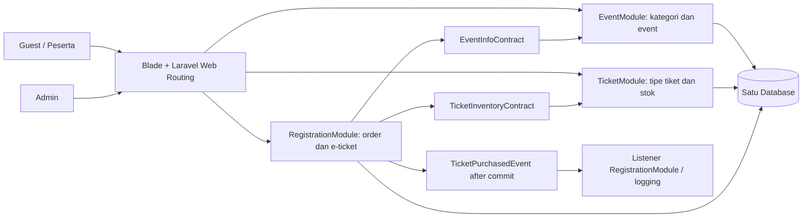
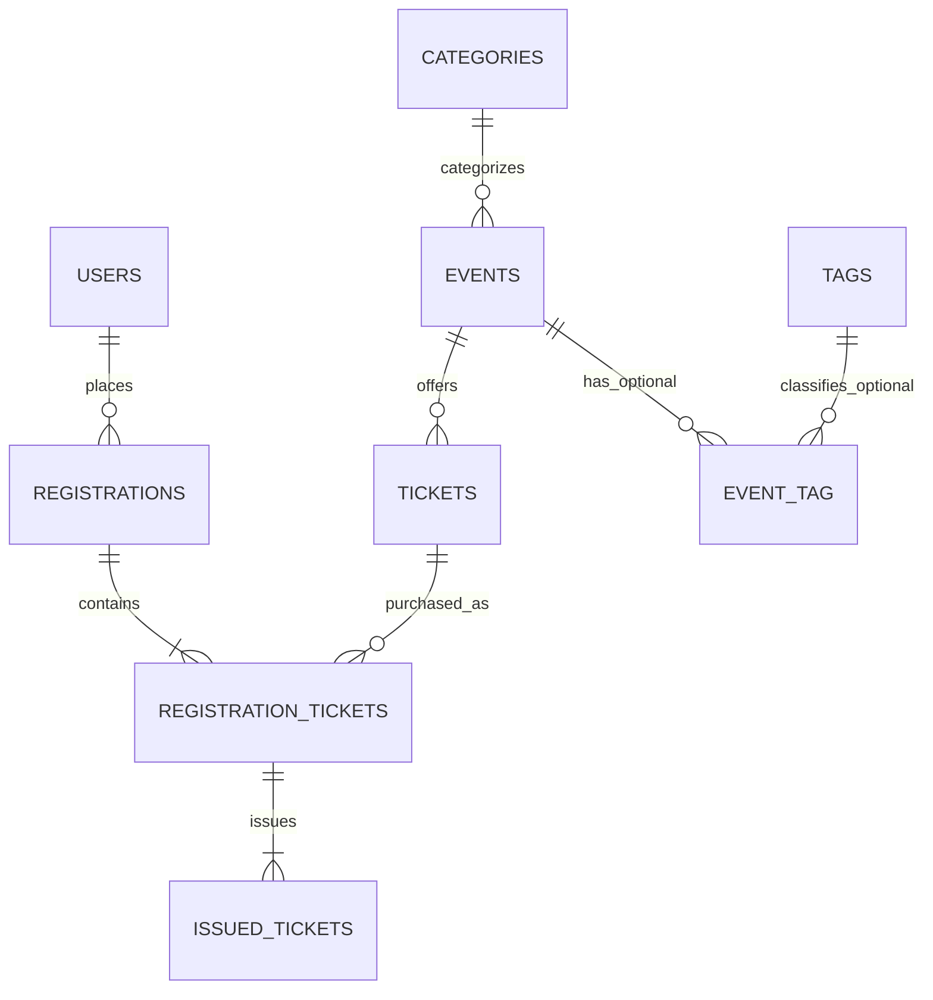
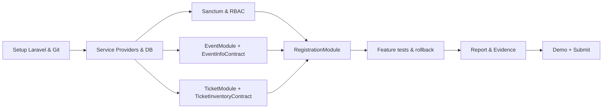

# ROADMAP & DOKUMENTASI IMPLEMENTASI UTS BACKEND DEVELOPMENT — V3
## Sistem Manajemen Event & Tiket — Laravel 13 Modular Monolith

**Status:** Dokumen perencanaan implementasi; bukan bukti bahwa aplikasi sudah dibuat atau diuji.  
**Tanggal penyusunan:** 16 November 2026  
**Acuan utama:** `UTS-REGULER-DT199-BACKEND-DEVELOPMENT-GANJIL-2026-2027-FIX.pdf` (5 halaman)  
**Blueprint awal:** `blueprint_event_tiket_lengkap.md`  
**Prioritas sumber:** instruksi dan rubrik PDF dosen > blueprint awal > rekomendasi rekayasa perangkat lunak dalam dokumen ini.
**Revisi V3 (16 November 2026):** seluruh tabel aplikasi milik kelompok wajib memiliki UUID `id` (primary key), `created_at`, UUID `created_by`, `updated_at`, UUID `updated_by` dan pembagian kerja dikunci untuk **3 anggota**. Ketentuan ini adalah keputusan tambahan kelompok, **bukan teks eksplisit soal dosen**. Tabel infrastruktur Laravel dikecualikan sebagai skema framework kecuali ada alasan dan pengujian tersendiri.


> **Penting:** Studi kasus harus dikonfirmasi agar tidak sama dengan kelompok lain dalam kelas. Maksimal **3 anggota per kelompok**. Batas tanggal pengumpulan perlu dilihat pada dashboard; PDF tidak mencantumkan tanggal pastinya. Proyek harus berupa pekerjaan kelompok sendiri, dan riwayat commit harus memperlihatkan kontribusi nyata tiap anggota.

---

# A. RINGKASAN EKSEKUTIF & AUDIT BLUEPRINT

## A1. Keputusan inti

**Konvensi tambahan tim V3:** setiap tabel bisnis yang dibuat kelompok memiliki `id` UUID sebagai primary key, `created_at`, `created_by` UUID, `updated_at`, `updated_by` UUID; backend mengisi actor audit secara server-side dan wajib diuji pada pembuatan/edit/checkout/rollback.


Bangun **aplikasi web Laravel 13** berbasis **Blade Templates**, **PHP 8.4+** sesuai persyaratan khusus dosen, **MySQL** (pilihan tim; PostgreSQL/SQLite tetap diizinkan), **Laravel Sanctum**, **RBAC `admin`/`peserta`**, dan **3 modul utama**: `EventModule`, `TicketModule`, `RegistrationModule`. Source di GitHub public; final laporan PDF dan video demo YouTube unlisted maksimal 10 menit.

**Catatan versi:** Situs Laravel menyatakan Laravel 13 secara umum mendukung PHP >=8.3, tetapi *soal UTS secara eksplisit mensyaratkan PHP 8.4+*. Karena itu gunakan PHP 8.4 atau lebih baru.

## A2. Audit dan perubahan yang direkomendasikan (jangan diam-diam menyalin blueprint sebagai kode final)

| No | Bagian blueprint | Masalah/risiko | Perbaikan yang digunakan |
|---|---|---|---|
| 1 / F0–F1 | Checkout hanya inject `TicketInventoryContract` | Klaim mengecek event melalui `EventInfoContract` belum terwujud | Inject `EventInfoContract`, pastikan event `published`, jadwal sesuai |
| 2 / F2 | `Registration::tickets()->attach()` dengan `Ticket` model | Berisiko melanggar larangan mengakses model modul lain secara langsung | Simpan `registration_tickets` memakai model/repository milik `RegistrationModule`; akses harga/kuota Tiket hanya via Contract. Untuk bukti Eloquent `belongsToMany` yang benar-benar *di dalam satu modul*, tambahkan relasi `Event`–`Tag` opsional (disarankan untuk target rubrik tinggi) |
| 3 / F3 | Event `TicketPurchasedEvent` dilistener oleh `EventModule` | Dependensi balik ke Registration dapat menciptakan coupling/siklus | Listener tetap di `RegistrationModule` atau event integrasi di shared namespace; tidak memanggil model Event langsung |
| 4 / F4 | `TicketPurchasedEvent::dispatch()` di dalam transaksi | Listener dapat berjalan sebelum commit / tetap menimbulkan efek samping jika rollback | Implementasikan `ShouldDispatchAfterCommit`, atau dispatch setelah transaksi berhasil |
| 5 / F5 | Pivot dengan `quantity=2` tetapi hanya satu `ticket_code` | Dua tiket masuk tidak memperoleh dua identitas | Tambahkan tabel `issued_tickets` (1 kode per tiket individual) sementara `registration_tickets` menyimpan baris pesanan dan snapshot harga |
| 6 / F6 | Klaim `Str::random()` menjamin unik | Nilai acak tidak memberi jaminan mutlak | Tambahkan `UNIQUE(ticket_code)` dan retry terbatas saat collision |
| 7 / F6 | Harga di-cast `(float)` | Angka uang dapat mengalami masalah presisi | Gunakan integer rupiah (`price_rupiah`) secara konsisten atau DECIMAL dengan perhitungan fixed-precision; dokumen ini memakai integer rupiah |
| 8 / F7 | `deductQuota` memakai `lockForUpdate` | Benar hanya bila dipanggil dalam transaksi; stok bisa oversold bila implementasi disiplin transaksi salah | Kontrak menegaskan harus ada transaksi; gunakan database transaksi, urutan penguncian konsisten, uji concurrent checkout pada MySQL |
| 9 / F8 | Contoh route katalog publik memakai `auth` | Tidak konsisten dengan klaim publik boleh lihat published event | Katalog event `published` bisa diakses guest; checkout/riwayat wajib login |
| 10 / F9 | Rollback diuji ketika kuota belum cukup | Menolak sebelum mutasi belum membuktikan rollback atas perubahan yang sudah sempat terjadi | Tambahkan uji multi-item: item A berhasil dipotong, item B gagal, lalu cek kuota A pulih dan tak ada record pembelian |
| 11 | Penjelasan Sanctum tanpa instalasi & bukti | Login web `auth` saja tidak membuktikan setup Sanctum | Jalankan `install:api`, pasang Sanctum pada User, uji `auth:sanctum` dan dokumentasikan login berbasis session |
| 12 | Status `completed` setelah checkout | Bisa disalahartikan sebagai pembayaran uang sungguhan | Untuk UTS, definisikan checkout sebagai **simulasi pembelian sukses**; gateway pembayaran bukan lingkup wajib |

**Keputusan ruang lingkup:** 3 modul utama tetap seperti blueprint. Tabel pendukung seperti `issued_tickets` atau `tags` tidak berarti modul keempat. Perluasan `Event`–`Tag` bersifat *opsi penguatan bukti relasi Eloquent M-N*, bukan fitur wajib studi kasus.

## A3. Rubrik dosen sebagai target kualitas

| Kriteria PDF halaman 4–5 | Bobot | Bukti konkret |
|---|---:|---|
| Struktur Modular Monolith | 15% | Direktori 3 modul; tiga provider terdaftar; batas import jelas |
| Komunikasi Antar Modul | 15% | Interface Event/Ticket; checkout pakai Contract; event after-commit |
| Relasi Antar Tabel | 15% | ERD; 1-N; pivot M-N; demonstrasi relasi bekerja |
| Autentikasi & Otorisasi | 10% | Sanctum, login/register, 2 role, middleware, test 403 |
| Validasi & Error Handling | 10% | Form Request untuk seluruh form, exception dan pesan informatif |
| Database Transaction | 10% | Bukti sukses, failed checkout, rollback multi-item |
| Kualitas Kode & Git | 10% | Pint, test, commit bertahap per anggota |
| Laporan & Dokumentasi | 10% | BAB I–V, diagram akurat, screenshot, lampiran |
| Video Demo | 5% | Video <=10 menit, rekaman fitur inti jelas |
| **Total** | **100%** | **Seluruh butir harus memiliki bukti** |

---

# B. BATAS PRODUK (MVP) DAN KRITERIA SELESAI

## B1. Use case inti

**Publik/guest:** melihat daftar event published, detail event, harga dan sisa tiket (tanpa data sensitif).  
**Peserta:** register, login, logout; melihat event; memilih jenis & jumlah tiket; checkout; melihat daftar pesanan dan e-ticket berkode unik; hanya melihat miliknya.  
**Admin:** login; CRUD kategori, event dan jenis tiket; ubah status published; set harga, kuota, periode jual; melihat rekap pendaftaran.

**Bukan scope wajib:** payment gateway sungguhan, pengiriman email, QR scan di venue, refund otomatis, dashboard analytics rumit, API mobile, deployment berbayar. Dapat ditambahkan hanya setelah semua rubrik aman.

## B2. Aturan bisnis wajib

1. Hanya event berstatus `published` yang boleh dibeli; event `cancelled`/`draft` ditolak.
2. Hanya tiket yang periode penjualannya sedang aktif yang boleh dibeli.
3. `quantity` bilangan bulat >=1; tetapkan batas per pesanan (contoh 10) dalam konfigurasi Form Request.
4. Server menghitung total dari harga database, bukan angka dari browser.
5. Setiap pembelian melakukan perubahan kuota dan pembuatan order **dalam satu transaksi DB**.
6. Jika salah satu item gagal, seluruh checkout gagal dan semua mutasi dibatalkan.
7. Setiap tiket individual mempunyai `ticket_code` yang berbeda dan indeks `UNIQUE`.
8. Peserta tidak bisa mengakses fitur atau data admin; peserta hanya boleh membuka pesanan miliknya.
9. Status order adalah `completed` untuk simulasi checkout berhasil; jangan mengklaim sudah menerima pembayaran online nyata.
10. Saat admin mengedit kuota, jangan sampai lebih kecil dari jumlah tiket yang sudah terjual. Pastikan tidak memotong stok pesanan sukses secara sepihak.

## B3. Definisi selesai (Definition of Done)

Satu fitur dianggap selesai jika: implementasi berjalan; Form Request relevan; otorisasi dan error handling benar; feature test lulus; dirapikan dengan Pint; reviewer sudah menyetujui PR; screenshot bukti tersimpan; commit tercatat atas nama kontributor. **Proyek selesai** jika seluruh fitur inti dan checklist penyerahan pada bagian N terpenuhi.

---

# C. ARSITEKTUR MODULAR MONOLITH

## C1. Diagram bounded context (target final)



**Aturan dependency:** `RegistrationModule` boleh mengenal **interface** milik `EventModule` dan `TicketModule`, tetapi **tidak boleh** mengimpor model, query builder, atau repository internal modul tersebut. `EventModule` dan `TicketModule` tidak boleh memanggil balik `RegistrationModule`. Semua memakai satu proses Laravel dan satu database, bukan microservice.

## C2. Pembagian kepemilikan modul

| Modul | Memiliki tabel | Tanggung jawab | Contract keluar |
|---|---|---|---|
| `EventModule` | `categories`, `events` (+ `tags`, `event_tag` opsional) | CRUD event/kategori, status publish, daftar event | `EventInfoContract` |
| `TicketModule` | `tickets` | CRUD jenis tiket, harga, kuota, cek periode jual, reserve/release | `TicketInventoryContract` |
| `RegistrationModule` | `registrations`, `registration_tickets`, `issued_tickets` | Checkout, riwayat, e-ticket, event pembelian | Domain Event `TicketPurchasedEvent` |
| Core Laravel | `users`, `personal_access_tokens`, session | Login/register, Sanctum, role, auth middleware | Layanan auth Laravel |

**Prinsip migrasi:** FK lintas tabel boleh ditulis pada tingkat skema sebagai integritas database, tetapi **kode bisnis modul** tidak boleh membaca/memanipulasi model atau tabel internal modul lain langsung. Migrasi dapat memerlukan urutan yang eksplisit.

## C3. Struktur folder yang dituju

```text
event-ticket/
├── app/
│   ├── Http/Middleware/RoleMiddleware.php
│   ├── Models/User.php
│   ├── Modules/
│   │   ├── EventModule/
│   │   │   ├── Contracts/EventInfoContract.php
│   │   │   ├── Controllers/{CategoryController,EventAdminController,EventCatalogController}.php
│   │   │   ├── Database/{Migrations,Seeders,Factories}/
│   │   │   ├── Models/{Category,Event}.php
│   │   │   ├── Requests/{StoreCategoryRequest,StoreEventRequest,UpdateEventRequest}.php
│   │   │   ├── Routes/web.php
│   │   │   ├── Services/EventInfoService.php
│   │   │   ├── Providers/EventModuleServiceProvider.php
│   │   │   └── Views/{admin,public}/
│   │   ├── TicketModule/
│   │   │   ├── Contracts/TicketInventoryContract.php
│   │   │   ├── Controllers/TicketController.php
│   │   │   ├── Database/{Migrations,Seeders,Factories}/
│   │   │   ├── Exceptions/TicketQuotaExceededException.php
│   │   │   ├── Models/Ticket.php
│   │   │   ├── Requests/{StoreTicketRequest,UpdateTicketRequest}.php
│   │   │   ├── Routes/web.php
│   │   │   ├── Services/TicketInventoryService.php
│   │   │   ├── Providers/TicketModuleServiceProvider.php
│   │   │   └── Views/admin/
│   │   └── RegistrationModule/
│   │       ├── Controllers/{CheckoutController,RegistrationController}.php
│   │       ├── Database/{Migrations,Seeders,Factories}/
│   │       ├── Events/TicketPurchasedEvent.php
│   │       ├── Listeners/LogTicketPurchased.php
│   │       ├── Models/{Registration,RegistrationTicket,IssuedTicket}.php
│   │       ├── Requests/CheckoutRequest.php
│   │       ├── Routes/web.php
│   │       ├── Services/CheckoutService.php
│   │       ├── Providers/RegistrationModuleServiceProvider.php
│   │       └── Views/{checkout,history,eticket}/
│   └── Providers/AppServiceProvider.php
├── bootstrap/{app.php,providers.php}
├── resources/views/{layouts,auth,components}/
├── routes/{web.php,api.php}
├── tests/{Feature,Unit}/
├── docs/{diagrams,evidence,api,decisions}/
├── README.md
├── .env.example
├── composer.json
└── package.json
```

Catatan: kelas `Tag` dan `event_tag` dapat ditambahkan **di dalam EventModule** ketika memilih opsi demonstrasi Eloquent M-N tambahan.

## C4. Kontrak teknis antarmodul

```php
// app/Modules/EventModule/Contracts/EventInfoContract.php
namespace App\Modules\EventModule\Contracts;

interface EventInfoContract
{
    public function getSummary(string $eventId): ?array;
    public function isPurchasable(string $eventId): bool;
}
```

```php
// app/Modules/TicketModule/Contracts/TicketInventoryContract.php
namespace App\Modules\TicketModule\Contracts;

interface TicketInventoryContract
{
    public function getSummary(string $ticketId): ?array;

    /** WAJIB dipanggil dari dalam DB::transaction().
     * Mengambil row lock, validasi ketersediaan, dan mengurangi kuota.
     * Mengembalikan snapshot {id,event_id,name,price_rupiah,quantity}.
     */
    public function reserve(string $ticketId, int $quantity): array;

    /** Dipakai hanya jika fitur cancel resmi diimplementasikan. */
    public function release(string $ticketId, int $quantity): void;
}
```

Kontrak boleh mengembalikan DTO/array primitive, **jangan Eloquent model lintas modul**. DTO sebaiknya immutable jika memilih implementasi lebih formal. Gunakan konsisten nama method `reserve` (bukan campuran `reserve` dan `deductQuota`).

## C5. Service Provider setiap modul

Contoh `TicketModuleServiceProvider` (sesuaikan namespace dan lokasi folder saat membuat proyek):

```php
<?php
namespace App\Modules\TicketModule\Providers;

use Illuminate\Support\ServiceProvider;
use App\Modules\TicketModule\Contracts\TicketInventoryContract;
use App\Modules\TicketModule\Services\TicketInventoryService;

class TicketModuleServiceProvider extends ServiceProvider
{
    public function register(): void
    {
        $this->app->bind(TicketInventoryContract::class, TicketInventoryService::class);
    }

    public function boot(): void
    {
        $this->loadMigrationsFrom(__DIR__.'/../Database/Migrations');
        $this->loadRoutesFrom(__DIR__.'/../Routes/web.php');
        $this->loadViewsFrom(__DIR__.'/../Views', 'ticket');
    }
}
```

Tambahkan ketiga provider ke `bootstrap/providers.php`; `register()` untuk binding, `boot()` untuk routes/migrations/views. Pastikan file routes modul mengelompokkan route Blade di bawah middleware `web`, agar session/CSRF tersedia. **Verifikasi dengan `php artisan route:list`**.

---

# D. DESAIN DATABASE FINAL (REVISI BLUEPRINT)

## D1. ERD skematis



Relasi `REGISTRATIONS` ↔ `TICKETS` tetap merupakan **many-to-many melalui `registration_tickets`**. Untuk menunjukkan `belongsToMany()` secara Eloquent tanpa melanggar batas modul, opsi `EVENTS` ↔ `TAGS` via `event_tag` dapat dilaksanakan murni di `EventModule`.


## D2.0 Keputusan V3: UUID end-to-end (wajib pada tabel aplikasi)

**Ini keputusan kelompok, bukan persyaratan eksplisit PDF UTS.** Seluruh tabel yang **dirancang kelompok**, termasuk `users`, `categories`, `events`, `tickets`, `registrations`, `registration_tickets`, `issued_tickets`, serta tabel opsional `tags` dan `event_tag`, menggunakan UUID untuk `id` dan seluruh FK yang merujuk ID tersebut. Kolom audit `created_by` dan `updated_by` juga UUID nullable dan mengacu ke `users.id`.

- UUID bukan nomor tiket/invoice. `ticket_code` dan `invoice_number` tetap string unik terpisah.
- Untuk Laravel, gunakan `HasUuids` pada model domain dan `User`; Laravel dapat membuat UUID ketika model Eloquent dibuat. Untuk `DB::table()->insert()`, `attach()` atau pivot tanpa model yang mengelola key, **isi `id` secara eksplisit dengan `Str::uuid()` atau gunakan custom pivot model dengan `HasUuids` dan pengujian**.
- Gunakan `$table->uuid('id')->primary()` dan `$table->foreignUuid('...')->constrained('...')`. Jangan mencampur `foreignId` integer dengan UUID.
- Untuk UUID yang berasal dari request, gunakan rule `uuid`; untuk Contract dan DTO gunakan `string` (atau value object UUID yang disepakati), bukan `int`. Route model binding menggunakan string UUID.
- Untuk MySQL UUID tersimpan sebagai representasi teks sesuai tipe Laravel; optimasi binary UUID adalah opsi lanjutan, **tidak diperlukan untuk UTS**. Hindari klaim bahwa UUID selalu lebih cepat dibanding bigint.
- Tabel internal framework seperti `migrations`, `cache`, `jobs`, `sessions`, `personal_access_tokens` tetap menggunakan skema Laravel kecuali integrasi memerlukan perubahan yang terdokumentasi dan diuji. `personal_access_tokens` dapat memakai morph type yang sesuai model UUID jika diperlukan; uji token Sanctum benar-benar bisa diterbitkan/dibaca.
- Audit `users.created_by`/`updated_by` dapat dibuat nullable tanpa FK self-reference pada migration awal; bila FK self-reference dibutuhkan, tambahkan setelah tabel tersedia.

### Contoh User UUID + relasi audit

```php
// Migration users (sesuaikan migration bawaan; jangan buat tabel users dua kali)
$table->uuid('id')->primary();
$table->string('name');
$table->string('email')->unique();
$table->string('password');
$table->string('role')->default('peserta');
$table->timestamps();
$table->foreignUuid('created_by')->nullable();
$table->foreignUuid('updated_by')->nullable();

// App\Models\User: tambahkan trait HasUuids bersama trait auth/Sanctum yang digunakan.
use Illuminate\Database\Eloquent\Concerns\HasUuids;
// class User extends Authenticatable { use HasUuids, HasApiTokens, ...; }
```

### Contoh pivot UUID dibuat secara eksplisit

```php
// Di service pemilik pivot, bukan menerima id/created_by dari browser
RegistrationTicket::create([
    'id' => (string) \Illuminate\Support\Str::uuid(),
    'registration_id' => $registration->id,
    'ticket_id' => $snapshot['id'],
    'quantity' => $qty,
    'unit_price_rupiah' => $snapshot['price_rupiah'],
    'subtotal_rupiah' => $subtotal,
    'created_by' => auth()->id(),
    'updated_by' => auth()->id(),
]);
```

**Checklist migrasi UUID:** periksa semua FK, migration, seeder, factory, Sanctum, route model binding, Form Request, DTO/Contract, event payload, Eloquent pivot, JSON response, serta test fixture. Jika database V2 sudah pernah dibuat pada lingkungan development, lakukan migrasi ulang terencana dan backup sebelum reset; `migrate:fresh` **hanya** untuk data development/test yang boleh dihapus.

## D2. Skema tabel V3 — standar audit di setiap tabel aplikasi

**Keputusan kelompok (tambahan terhadap PDF dosen):** setiap tabel domain/aplikasi dan setiap pivot yang kita buat sendiri mempunyai **lima kolom wajib** berikut:

| Kolom bersama di setiap tabel aplikasi | Tipe MySQL/Laravel | Kebijakan |
|---|---|---|
| `id` | `UUID PRIMARY KEY` / `$table->uuid('id')->primary()` | UUID untuk tabel utama **dan pivot**, tidak auto-increment |
| `created_at` | `TIMESTAMP NULL` / `$table->timestamps()` | Otomatis saat insert |
| `created_by` | `UUID NULL` / `$table->foreignUuid(...)`, referensi `users.id` (UUID) | Diisi dari konteks autentikasi; `NULL` untuk sistem/guest/seeder |
| `updated_at` | `TIMESTAMP NULL` / `$table->timestamps()` | Otomatis saat insert/update |
| `updated_by` | `UUID NULL` / `$table->foreignUuid(...)`, referensi `users.id` (UUID) | Diisi dari aktor yang melakukan update, bukan request client |

**Tabel aplikasi yang wajib mengikuti pola** (`[AUDIT5]` = kelima kolom di atas, bukan hanya penanda dokumentasi):

| Tabel — pemilik | Kolom khusus (selain `[AUDIT5]`) | Kunci/index serta ketentuan |
|---|---|---|
| `users` — Core/Auth | `name`, `email`, `password`, `role` | UNIQUE `email`; role `admin/peserta`; `created_by` dapat NULL pada registrasi mandiri; hindari delete fisik user bertransaksi |
| `categories` — Event | `name`, `slug`, `description` | UNIQUE `slug` |
| `events` — Event | `category_id`, `title`, `slug`, `description`, `location`, `start_time`, `end_time`, `status`, `banner_path` | FK category; UNIQUE `slug`; `end_time > start_time`; index `(status,start_time)` |
| `tickets` — Ticket | `event_id`, `name`, `price_rupiah`, `initial_quota`, `remaining_quota`, `sales_start`, `sales_end`, `status` | FK event; harga integer >=0; `0 <= remaining_quota <= initial_quota`; index `(event_id,status)` |
| `registrations` — Registration | `user_id`, `invoice_number`, `idempotency_key`, `total_rupiah`, `status`, `confirmed_at`, `cancelled_at` | FK user; UNIQUE invoice; UNIQUE `(user_id,idempotency_key)`; tidak menyatakan payment gateway terbayar |
| `registration_tickets` — Registration | `registration_id`, `ticket_id`, `quantity`, `unit_price_rupiah`, `subtotal_rupiah` | FK registration dan ticket; INDEX ticket; UNIQUE `(registration_id,ticket_id)` bila ticket ID tidak boleh berulang per order; price snapshot |
| `issued_tickets` — Registration | `registration_ticket_id`, `ticket_code`, `status`, `checked_in_at` | FK registration_tickets; UNIQUE `ticket_code`; **1 baris per tiket individual** |
| `tags` — Event (opsional) | `name`, `slug` | UNIQUE `slug`; untuk demonstrasi M-N internal EventModule |
| `event_tag` — Event (opsional) | `event_id`, `tag_id` | FK event dan tag; UNIQUE `(event_id,tag_id)` **ditambah `id` UUID surrogate** serta lima kolom audit |

`registration_tickets` adalah pivot konseptual M-N Registration–Ticket; akses model `Ticket` oleh `RegistrationModule` dilarang sehingga akses harga dan kuota tetap melalui Contract. Pilihan `tags` + `event_tag` merupakan alternatif demonstrasi Eloquent `belongsToMany()` seluruhnya dalam EventModule, agar tidak melanggar pembatasan modul pada PDF.

**Pengecualian yang harus jelas dalam dokumentasi:** tabel *infrastruktur yang dimiliki framework* (`migrations`, `cache`, `cache_locks`, `sessions`, `jobs`, `failed_jobs`, `password_reset_tokens`, `personal_access_tokens` dan tabel sejenis yang muncul bergantung instalasi) tidak dipaksa menjadi skema `[AUDIT5]`. Laravel bisa mengharapkan primary key/struktur kolom tertentu pada tabel internal. Jika dosen meminta secara literal seluruh tabel termasuk bawaan framework, diskusikan secara eksplisit terlebih dahulu; jangan sembarang memodifikasi vendor migrations. Semua tabel **yang kelompok desain sendiri** tetap wajib mengikuti ketentuan `[AUDIT5]` tanpa kecuali.

### D2.1 Template migration untuk tabel domain

```php
Schema::create('categories', function (Blueprint $table) {
    $table->uuid('id')->primary();
    $table->string('name');
    $table->string('slug')->unique();
    $table->text('description')->nullable();

    $table->timestamps();  // created_at & updated_at
    $table->foreignUuid('created_by')->nullable()
        ->constrained('users')->restrictOnDelete();
    $table->foreignUuid('updated_by')->nullable()
        ->constrained('users')->restrictOnDelete();
});
```

**Catatan FK audit:** `restrictOnDelete()` membantu menjaga atribusi historis agar tidak hilang; gunakan kebijakan tidak melakukan hard-delete user yang menjadi aktor audit. Jika ada kebutuhan penghapusan identitas pengguna, rancang kebijakan retensi/anonymization tersendiri. `users` sendiri bisa mempunyai `created_by/updated_by` nullable tanpa FK self-referential pada migration awal, lalu tambahkan FK terpisah bila diputuskan aman. Nilai `NULL` adalah keadaan sah untuk seeder, system job, dan registrasi mandiri.

### D2.2 Contoh khusus pivot `event_tag`

```php
Schema::create('event_tag', function (Blueprint $table) {
    $table->uuid('id')->primary(); // DITAMBAHKAN walau pivot Eloquent default biasanya komposit
    $table->foreignUuid('event_id')->constrained('events')->restrictOnDelete();
    $table->foreignUuid('tag_id')->constrained('tags')->restrictOnDelete();
    $table->unique(['event_id', 'tag_id']);

    $table->timestamps();
    $table->foreignUuid('created_by')->nullable()
        ->constrained('users')->restrictOnDelete();
    $table->foreignUuid('updated_by')->nullable()
        ->constrained('users')->restrictOnDelete();
});
```

Saat memanggil `belongsToMany(...)->withTimestamps()` untuk pivot, field `created_at`/`updated_at` dapat dikelola Eloquent; **`created_by` dan `updated_by` tidak terisi otomatis** saat `attach()`/`sync()` kecuali payload dibuat secara eksplisit oleh service/pivot model. Larang operasi `sync()` tanpa pemeriksaan audit dan policy akses.

### D2.3 Pengisian audit untuk Eloquent vs mutasi kuota langsung

Untuk `Model::create()`, `$model->save()`, dan `$model->update()`, gunakan **trait/observer bersama** pada model aplikasi untuk mengisi `created_by` di operasi create dan `updated_by` saat update, dari `Auth::id()`. Jangan menerima kedua kolom audit dari `request()->all()` atau mass assignment publik. Jangan mengubah `created_by` pada update. Pada user registration guest, `created_by = NULL` sah.

**Penting:** `DB::table(...)->update()`, query builder bulk update, `attach()` pada pivot, dan update stok pada level query **dapat melewati event model Eloquent**. Pada operasi ini field `updated_by` dan `updated_at` harus disetel eksplisit. Untuk `TicketInventoryService`, contoh:

```php
Ticket::query()->whereKey($ticketId)->update([
    'remaining_quota' => $newRemainingQuota, // dihitung dari row TERKUNCI
    'updated_by' => auth()->id(),
    'updated_at' => now(),
]);
```

Jangan menjalankan query tersebut sebagai pengganti `lockForUpdate()`/`DB::transaction()`: ia hanya menunjukkan **stamping audit** di dalam alur transaksi yang sudah dikunci dengan benar. Proses setelah commit/job tanpa user bisa memakai `NULL` sebagai aktor sistem; bila harus mengetahui penanggung jawab awal, bawa `actorId` secara eksplisit sebagai konteks layanan. Agar aman terhadap mass assignment, lakukan whitelist field pada Form Request dan Controller.

### D2.4 Pengujian audit yang wajib ditambahkan

- Create event sebagai Admin A: `created_by=A`, `updated_by=A` (atau NULL sampai update bila kebijakan demikian; proyek ini memilih `A`), timestamps terisi.
- Edit oleh Admin B: `created_by` tetap A, `updated_by=B`, `updated_at` berubah.
- Checkout peserta: `created_by` pada registration, pivot, issued ticket menunjukkan peserta; tidak ada input aktor dari browser.
- Kurangi kuota saat checkout: `tickets.updated_by` menunjukkan aktor pemesan dan `tickets.updated_at` berubah **dalam transaksi yang sama**; rollback harus mengembalikan keduanya seperti sebelum transaksi.
- Data seeder dan register guest: `created_by/updated_by` nullable tidak memicu foreign-key error.
- Pivot `event_tag`: UUUUID unik dan `created_by/updated_by` terisi pada attach/update sesuai actor.
- Input `created_by=<UUID-palsu>` atau `updated_by=<UUID-palsu>` yang dimanipulasi user diabaikan.

**Money decision:** gunakan integer rupiah agar perhitungan akurat. Untuk multi-ticket, satu baris `registration_tickets` memuat jumlah dan snapshot harga, sedangkan `issued_tickets` menampung satu kode unik untuk tiap unit.

## D3. Migrasi dan urutan FK

Urutan logis migrasi: `users` → `categories` → `events` → `tickets` → `registrations` → `registration_tickets` → `issued_tickets` (opsional `tags` → `event_tag` setelah `events`). Kolom `created_by/updated_by` pada tabel domain memerlukan tabel `users` sudah ada lebih dulu. Bila migrasi modul terpisah, atur timestamp file migrasi dan cek fresh migrate. Jalankan `php artisan migrate:fresh --seed` **hanya pada DB development/testing** karena menghapus tabel. Jangan pernah pada database berisi data pengguna nyata.

## D4. Seeder dan Factory

Siapkan minimal: 1 admin, 2 peserta, 3 kategori, 5 event (draft/published/cancelled), beberapa tipe tiket per event, satu tiket kuota 0, satu tiket sisa 1, dan contoh registrasi jika perlu. Password akun demo hash; `.env` serta rahasia nyata jangan masuk public GitHub. Buat Factory untuk Event, Ticket, Registration dan kategori jika memungkinkan.

---

# E. PERSIAPAN PROYEK — DARI NOL

## E1. Prasyarat perangkat

- PHP **8.4+** (syarat PDF); PHP extensions Laravel yang diperlukan.
- Composer; Git; akun GitHub; Node.js LTS dan npm.
- MySQL lokal; editor VS Code/PhpStorm; browser.
- Windows: gunakan lingkungan PHP yang menyediakan PHP 8.4, misalnya Laravel Herd atau setup PHP lokal yang benar. Samakan major PHP dan database di semua anggota.

Pemeriksaan awal:

```bash
php -v
composer --version
node --version
npm --version
git --version
```

## E2. Inisialisasi Laravel 13

```bash
composer create-project laravel/laravel event-ticket "^13.0"
cd event-ticket
php artisan --version
cp .env.example .env   # Linux/macOS/Git Bash; di PowerShell: Copy-Item .env.example .env
php artisan key:generate
php artisan install:api
npm install
```

Set `.env` (contoh lokal, bukan kredensial produksi):

```dotenv
APP_NAME="Event Ticket UTS"
APP_ENV=local
APP_DEBUG=true
APP_URL=http://127.0.0.1:8000
DB_CONNECTION=mysql
DB_HOST=127.0.0.1
DB_PORT=3306
DB_DATABASE=uts_event_ticket
DB_USERNAME=root
DB_PASSWORD=
SESSION_DRIVER=database
```

Jika database session dipilih, cek keberadaan migrasi `sessions` bawaan scaffold. Sesuaikan nama DB dan kredensial dengan mesin masing-masing. Setelah konfigurasi:

```bash
php artisan migrate
php artisan route:list
npm run build
php artisan serve
```

Cek browser di `http://127.0.0.1:8000`. Untuk pengembangan aktif dapat menggunakan `npm run dev` pada terminal lain.

## E3. Setup GitHub kolaboratif

```bash
git init
git add .
git commit -m "chore: initialize Laravel 13 project"
git branch -M main
git remote add origin https://github.com/OWNER/REPOSITORY.git
git push -u origin main
```

Untuk setiap fitur: `git checkout -b feat/event-crud`, commit kecil jelas, push, buka Pull Request, review, merge. **Jangan berbagi satu akun Git**: setiap anggota memakai identity Git masing-masing. Contoh naming: `feat: add ticket quota contract`, `test: verify checkout rollback`, `fix: block participant from admin routes`, `docs: add bounded context diagram`.

## E4. Keputusan penting sebelum coding

Catat di `docs/decisions/001-architecture.md`: studi kasus terkonfirmasi; maksimal 3 anggota; stack; database; nama contract; format uang; arti checkout simulasi; desain kode per tiket individual; apakah relasi Event–Tag opsional diambil. Jangan mengubah keputusan diam-diam setelah migrasi dan implementasi berjalan.

---

# F. ROADMAP PELAKSANAAN BERGATE

> **Estimasi contoh:** 10 hari kerja efektif untuk 3 anggota, **bukan** tanggal resmi UTS. Durasi sangat bergantung kemampuan kelompok. Lebih penting urutan dependensi dan exit criteria daripada mengikuti estimasi persis.

| Fase | Estimasi | Hasil minimal | Syarat lanjut (exit gate) |
|---|---|---|---|
| 0. Validasi soal & scope | Hari 1 | Konfirmasi kasus, daftar fitur, arsitektur disepakati | Tidak ada ketidakpastian aturan kampus |
| 1. Setup repo & Laravel | Hari 1 | Laravel 13 PHP8.4, DB, Sanctum, GitHub | Semua anggota bisa menjalankan proyek |
| 2. Modul & migration | Hari 2 | 3 Provider; model, ERD, migrations, seeders/factories | `migrate:fresh --seed`, `route:list` sukses |
| 3. Auth & RBAC | Hari 3 | Login/register, logout, middleware role | Test role dan akses peserta/admin lulus |
| 4. EventModule | Hari 4 | CRUD kategori/event, katalog publik, Event Contract | CRUD+validation+publish test lulus |
| 5. TicketModule | Hari 5 | CRUD tiket, quota, Ticket Contract + exception | Reserve atomic dan test stok lulus |
| 6. RegistrationModule | Hari 6–7 | Checkout, pivot, issued ticket, history | Transaksi, rollback, unique code lulus |
| 7. Integrasi & keamanan | Hari 8 | Semua flow ujung ke ujung, tests, Pint | Seluruh feature tests lulus |
| 8. Laporan & bukti | Hari 9 | BAB I–V, screenshot, diagram, peer assessment | Rubrik & laporan checklist lulus |
| 9. Demo & final submit | Hari 10 | Video <=10m, public GitHub, PDF final | Link terbuka, upload ke dashboard berhasil |

## F0 — Validasi tugas dan peran

- [ ] Konfirmasi pemilihan Studi Kasus 5 ke dosen/asisten (tidak dipakai kelompok lain dalam kelas).
- [ ] Periksa tanggal/jam tenggat di dashboard mahasiswa; simpan screenshot pengumuman.
- [ ] Pastikan maksimal 3 anggota dan identitas lengkap untuk cover.
- [ ] Buat Trello/GitHub Projects sederhana: Backlog, In Progress, Review, Done.
- [ ] Tetapkan konvensi Git/branch, jadwal sinkronisasi harian, dan keputusan teknis.
- [ ] Tulis `README.md` awal dan simpan diagram arsitektur.

**Output bukti:** daftar anggota, daftar kebutuhan, persetujuan studi kasus, issue board.

## F1 — Setup & struktur modul

- [ ] Buat project Laravel 13, environment lokal, Sanctum, repository public.
- [ ] Tambahkan 3 folder modul + 3 Service Provider.
- [ ] Register provider di `bootstrap/providers.php`.
- [ ] Set `loadMigrationsFrom()`, `loadRoutesFrom()` tiap provider; `loadViewsFrom()` direkomendasikan.
- [ ] Terapkan middleware `web` pada route Blade dan konvensi nama route.
- [ ] Verify `php artisan route:list`, `php artisan about`.

**Output bukti:** screenshot struktur app/Modules dan providers, daftar route.

## F2 — Database, seeder, dan factory

- [ ] **Standar V2:** tambahkan Audit5 pada semua tabel aplikasi, termasuk pivot `registration_tickets` dan `event_tag` bila ada; buat test audit actor, UNIQUE, FK, dan rollback audit.

- [ ] Buat migration sesuai tabel/constraint di bagian D.
- [ ] Gunakan FK, index, `unique()` untuk invoice/kode tiket.
- [ ] Model dengan `fillable`, `casts`, query scope; 1-N `Category::events()`.
- [ ] M-N `registrations`↔`tickets` dapat dibuktikan di ERD & pivot; bila memilih proof Eloquent M-N bebas-cross-module, buat `Event::tags()` dan `Tag::events()` di EventModule.
- [ ] Siapkan factory/seeder data demo yang mencakup kondisi stok habis.
- [ ] Jalankan ulang migrate fresh seed pada DB development.

**Output bukti:** ERD, migrations, hasil seeder, screenshot data tabel.

## F3 — Auth & RBAC

- [ ] Install Sanctum, `HasApiTokens` di model User, migration token, login/register dengan session.
- [ ] Berikan `role` default peserta di sisi server; jangan izinkan pendaftar menetapkan `admin` sendiri.
- [ ] Buat middleware `role:admin` / `role:peserta`, daftarkan alias di `bootstrap/app.php`.
- [ ] Terapkan `auth:sanctum` pada route terproteksi dan middleware `web` untuk Blade.
- [ ] Uji guest redirect, peserta 403 admin route, admin bisa CRUD.
- [ ] Uji peserta A tidak dapat melihat e-ticket peserta B.

**Output bukti:** login dan register berhasil, screenshot penolakan akses, kode middleware.

## F4 — EventModule

- [ ] CRUD kategori (nama, slug, deskripsi) + Form Request.
- [ ] CRUD event (title, slug, category, jadwal, venue, deskripsi, status) + Form Request.
- [ ] Cegah `end_time <= start_time` dan slug duplikat.
- [ ] Katalog publik hanya event `published`; detail event menggunakan slug.
- [ ] Buat EventInfoService + binding EventInfoContract.
- [ ] Test admin boleh edit, peserta tidak, published-only filter.

**Output bukti:** halaman CRUD, event published, validation error, contract.

## F5 — TicketModule

- [ ] CRUD tipe tiket terkait event via ID/FK; field `price_rupiah`, kuota awal dan sisa, periode jual.
- [ ] Validasi `initial_quota >= 0`, `sales_end >= sales_start`, harga tidak negatif.
- [ ] Sediakan getSummary + reserve pada `TicketInventoryContract`.
- [ ] Implementasikan `TicketQuotaExceededException` (render HTML/JSON yang informatif).
- [ ] `reserve()` memanggil model Ticket milik TicketModule dengan `lockForUpdate()` **di transaksi aktif**.
- [ ] Test quota 0, permintaan > sisa, quantity 0, periode penjualan di luar batas.

**Output bukti:** CRUD ticket, Contract+Service, custom exception dan error view.

## F6 — RegistrationModule & checkout

- [ ] CheckoutRequest validasi `items` sebagai array nonkosong, ticket_id valid, quantity 1..10, batasi duplikat ticket_id.
- [ ] CheckoutService menggunakan **kedua** Contract; tanpa import Eloquent Ticket/Event.
- [ ] Kunci dan potong stok dalam transaksi, simpan registration header, pivot details, lalu buat satu issued_tickets per unit.
- [ ] Generate invoice dan kode menggunakan random yang cukup kuat + `UNIQUE` database, tangani kemungkinan collision dengan retry.
- [ ] Dispatch TicketPurchasedEvent setelah commit, bukan memicu side effect sebelum commit.
- [ ] Peserta melihat history + detail + e-ticket miliknya; admin melihat rekap.
- [ ] Test transaksi sukses, rollback parsial, unique codes, wrong owner 403, concurrent last seat.

**Output bukti:** flow pembelian, kuota sebelum/sesudah, transaksi dan e-ticket unik, bukti rollback.

## F7 — Quality gate

- [ ] `php artisan test` sukses (unit + feature).
- [ ] `./vendor/bin/pint --test` sukses, kemudian `./vendor/bin/pint` untuk format bila dibutuhkan.
- [ ] `php artisan route:list` periksa auth dan nama route.
- [ ] Uji XSS output Blade escaped, CSRF form, mass assignment, ownership.
- [ ] Cek tidak ada `use App\Modules\TicketModule\Models` di RegistrationModule dan tidak ada akses tabel internal lintas modul dari service modul lain.
- [ ] Cek `APP_DEBUG=false` di environment demo publik/deploy; `.env` tidak di Git.
- [ ] Integrasi manual: admin buat event → tiket → peserta checkout → riwayat → stok berkurang → gagal saat stok habis.

**Output bukti:** screenshot test, Pint, commit history, checklist security.

## F8 — Dokumen & final submission

- [ ] Gambar final Bounded Context dan ERD **sesuai migrasi nyata**.
- [ ] Kumpulkan screenshot kode, hasil fitur, form invalid, custom exception, rollback.
- [ ] Tuliskan BAB I–V dan lampiran sesuai bagian M.
- [ ] Finalisasi kontribusi, peer assessment, video <=10 menit, GitHub public.
- [ ] Pastikan link bisa dibuka tanpa login; kumpulkan PDF bernama tepat.

---

# G. URUTAN KERJA TEKNIS / DEPENDENCY GRAPH



Untuk menghindari konflik Git, **buat contract lebih dulu** sebelum CheckoutService. Migration dipecah berdasarkan ownership. Sepakati penamaan route dan kolom database saat fase desain. PR Checkout harus menunggu interface Event/Ticket stabil.

---

# H. IMPLEMENTASI KUNCI — PANDUAN KODE

> Snippet berikut adalah **pedoman arsitektur** yang perlu dirangkai menjadi aplikasi dan diuji; bukan klaim bahwa kode sudah dikompilasi/dijalankan.

## H1. Middleware role (ringkas)

```php
// app/Http/Middleware/RoleMiddleware.php
namespace App\Http\Middleware;

use Closure;
use Illuminate\Http\Request;
use Symfony\Component\HttpFoundation\Response;

class RoleMiddleware
{
    public function handle(Request $request, Closure $next, string $role): Response
    {
        abort_unless($request->user()?->role === $role, 403, 'Akses ditolak.');
        return $next($request);
    }
}
```

Registrasikan alias pada konfigurasi middleware `bootstrap/app.php` (sesuai skeleton Laravel 13 yang terpasang). Controller tetap wajib membatasi kepemilikan record; middleware role saja tidak mencegah peserta membaca order orang lain.

## H2. Routing sesuai akses

| HTTP | URL contoh | Akses | Fungsi |
|---|---|---|---|
| GET | `/events` | publik | Katalog published |
| GET | `/events/{slug}` | publik | Detail event |
| GET/POST | `/register`, `/login` | guest | Register/login |
| POST | `/logout` | login | Logout |
| Resource | `/admin/categories` | admin | CRUD kategori |
| Resource | `/admin/events` | admin | CRUD event |
| Resource | `/admin/tickets` | admin | CRUD tiket |
| GET | `/checkout/{eventSlug}` | peserta | Halaman checkout |
| POST | `/checkout` | peserta | Proses transaksi |
| GET | `/my/registrations` | peserta | Riwayat |
| GET | `/my/registrations/{id}` | pemilik | Detail & e-ticket |
| GET | `/admin/registrations` | admin | Rekap pendaftaran |

Kedua jenis route terproteksi gunakan stack middleware `web`, `auth:sanctum`, dan `role:*` sesuai kebutuhan; route publik hanya perlu stack `web`. Seluruh form mutasi HTML memakai CSRF token `@csrf`.

## H3. Form Request checkout

```php
public function rules(): array
{
    return [
        'items' => ['required', 'array', 'min:1'],
        'items.*.ticket_id' => ['required', 'uuid', 'distinct'],
        'items.*.quantity' => ['required', 'integer', 'min:1', 'max:10'],
    ];
}
```

Validasi ticket ID benar-benar tersedia **di TicketModule Contract**; jangan mengakses tabel `tickets` dari `CheckoutRequest` milik RegistrationModule. Semua input CRUD juga memakai Form Request.

## H4. Core transaction (pseudocode Laravel agar tanggung jawab jelas)

```php
public function process(string $userId, array $items): Registration
{
    // Urutkan ticket_id agar lock multi-item lebih konsisten.
    usort($items, fn ($a, $b) => strcmp($a['ticket_id'], $b['ticket_id']));

    return DB::transaction(function () use ($userId, $items) {
        $prepared = [];
        $total = 0;

        foreach ($items as $item) {
            // Service milik TicketModule melakukan row lock, validasi,
            // dan deduct; kembaliannya scalar snapshot, bukan Model Ticket.
            $snapshot = $this->inventory->reserve(
                $item['ticket_id'],
                (int) $item['quantity']
            );

            if (! $this->events->isPurchasable($snapshot['event_id'])) {
                throw new DomainException('Event tidak tersedia untuk pembelian.');
            }

            $subtotal = (int) $snapshot['price_rupiah'] * (int) $item['quantity'];
            $prepared[] = [$snapshot, (int) $item['quantity'], $subtotal];
            $total += $subtotal;
        }

        $registration = Registration::create([
            'user_id' => $userId,
            'invoice_number' => $this->newUniqueInvoice(),
            'total_rupiah' => $total,
            'status' => 'completed',
        ]);

        foreach ($prepared as [$snapshot, $qty, $subtotal]) {
            $line = RegistrationTicket::create([
                'registration_id' => $registration->id,
                'ticket_id' => $snapshot['id'],
                'quantity' => $qty,
                'unit_price_rupiah' => $snapshot['price_rupiah'],
                'subtotal_rupiah' => $subtotal,
            ]);

            for ($i = 0; $i < $qty; $i++) {
                IssuedTicket::create([
                    'registration_ticket_id' => $line->id,
                    'ticket_code' => $this->newUniqueTicketCode(),
                    'status' => 'valid',
                ]);
            }
        }

        // Event class menerapkan ShouldDispatchAfterCommit.
        TicketPurchasedEvent::dispatch($registration->id);
        return $registration;
    }, attempts: 3);
}
```

**Catatan implementasi krusial:**

- Method `newUniqueInvoice()` dan `newUniqueTicketCode()` harus dibuat; hasil tetap memiliki DB `unique` index dan retry jika collision. Jangan menjadikan contoh ini kode siap-pakai tanpa method tersebut.
- `reserve()` harus mengunci row Ticket dengan `lockForUpdate()` pada koneksi database yang sama. Jangan membuka transaksi DB lain yang terpisah.
- Event validator `isPurchasable()` juga harus memeriksa status dan aturan waktu event. Untuk aturan yang rentan berubah ketika checkout bersamaan dengan tindakan admin, sepakati strategi konsistensi/lock dan uji race condition.
- Semua item satu checkout sebaiknya untuk **satu event** (lebih sederhana dan cocok dengan checkout dari detail event); jika lebih dari satu event, desain cart lintas event harus dinyatakan eksplisit.
- Fail di tengah transaksi harus melempar exception, **jangan hanya `return false`** karena akan menyebabkan commit.
- Cancellation/kuota kembali adalah fitur tambahan dan harus punya transaksi sendiri jika diimplementasikan.

## H5. Exception dan after-commit event

```php
// Exception dibuat di TicketModule.
class TicketQuotaExceededException extends \RuntimeException
{
    public function render(\Illuminate\Http\Request $request)
    {
        if ($request->expectsJson()) {
            return response()->json([
                'message' => $this->getMessage(),
            ], 422);
        }

        return back()->withInput()->with('error', $this->getMessage());
    }
}
```

```php
// Event milik RegistrationModule; listener bukan di EventModule.
use Illuminate\Contracts\Events\ShouldDispatchAfterCommit;
use Illuminate\Foundation\Events\Dispatchable;

class TicketPurchasedEvent implements ShouldDispatchAfterCommit
{
    use Dispatchable;

    public function __construct(public string $registrationId) {}
}
```

Di Blade, tampilkan `session('error')` dan error input `@error('field')`. Untuk array input, format pesan `@error('items.0.quantity')` dapat digunakan atau gunakan ringkasan `$errors->all()`.

---

# I. RENCANA PENGUJIAN TERSTRUKTUR

## I1. Matriks test dan bukti

| ID | Skenario | Ekspektasi | Level / Bukti |
|---|---|---|---|
| T01 | Guest buka event published | 200 + event tampil | Feature + screenshot |
| T02 | Guest buka event draft | 404 atau tidak tampil | Feature |
| T03 | Peserta login/register | session valid / redirect | Feature + screenshot |
| T04 | Peserta buka `/admin/events/create` | 403 | Feature + screenshot |
| T05 | Admin CRUD category/event | Record tersimpan & tampil | Feature + screenshot |
| T06 | Event end <= start | 422 / form error | Feature + screenshot |
| T07 | Admin buat tiket harga -1 | Ditolak Form Request | Feature |
| T08 | Peserta quantity 0 | Ditolak Form Request | Feature + screenshot |
| T09 | Checkout tiket qty 2; stock 5 | stock jadi 3, 1 order, 2 kode unik | Integration + screenshot |
| T10 | Checkout stock 1, quantity 2 | Exception, stock 1, tak ada order | Feature + screenshot |
| T11 | Item A ada stock, item B habis | A rollback ke nilai awal, tak ada header/detail/code | Integration + screenshot **wajib untuk bukti rollback** |
| T12 | Peserta A akses order peserta B | 403/404 | Feature |
| T13 | Ticket code berulang sengaja | UNIQUE DB menolak duplikasi | DB/Feature |
| T14 | Event `cancelled` dibeli | Ditolak; no stock mutation | Feature |
| T15 | Periode sale selesai | Ditolak | Feature |
| T16 | Dua pembelian concurrent saat stock 1 | Maksimal satu sukses; stok tidak negatif | Integration MySQL/PostgreSQL |
| T17 | Semua form memiliki Request rules | Input invalid gagal seragam | Feature/review |
| T18 | 3 provider berjalan | route & migration ter-load | CLI screenshot |
| T19 | Formatter code | Pint lulus | CLI screenshot |
| T20 | Boundary modules | Tidak ada direct model/tabel import lintas modul | Code review + grep |

## I2. Bukti rollback yang kuat

1. Seeder stok tiket A=2, tiket B=0.
2. Peserta checkout dua item: A sebanyak 1 dan B sebanyak 1.
3. Service memotong tiket A dalam transaksi, lalu `reserve(B)` melempar `TicketQuotaExceededException`.
4. Setelah respons error, cek lagi stok A tetap 2, B tetap 0, tidak ada tambahan `registrations`, `registration_tickets`, `issued_tickets`.
5. Screenshot stok sebelum/akhir + output test yang lulus; jelaskan bahwa rollback terjadi setelah pernah ada operasi pemotongan stok A.

**Mengapa penting:** ini membedakan transaksi yang benar-benar rollback dari validasi stok yang hanya menolak sebelum data berubah.

## I3. Command QA

```bash
php artisan migrate:fresh --seed        # hanya database lokal / test
php artisan test
./vendor/bin/pint --test
php artisan route:list
php artisan about
git log --oneline --graph --all --decorate
```

Untuk demo concurrency, jalankan test integration pada MySQL/PostgreSQL; perilaku lock SQLite tidak selalu setara dengan database server. Gunakan data fiktif, bukan informasi peserta nyata.

---

# J. PEMBAGIAN TUGAS 3 ANGGOTA — V4 (BERDASARKAN FASE ROADMAP)

**Prinsip:** pembagian berdasarkan fase F0–F9 adalah sumber kebenaran penugasan; ownership modul adalah pembagian tanggung jawab kode, bukan pengganti jadwal fase. Seluruh anggota memakai UUID untuk PK/FK/Contract/route model binding/test; satu modul = satu penanggung jawab utama; `users`/auth sebagai shared foundation; desain skema dan format Contract disepakati bersama sebelum coding. Estimasi beban relatif, **bukan skor kontribusi**: A 33%, B 30%, C 37% (checkout paling kompleks). Kontribusi akhir dibuktikan dari pekerjaan sungguhan dan riwayat commit, bukan angka ini.

| Personel | Ownership kode | Pekerjaan rinci | Dokumen & video | Output wajib / bukti |
|---|---|---|---|---|
| **Anggota 1 (A): EventModule + Auth/RBAC** | `app/Modules/EventModule/**`, `app/Models/User.php`, auth/middleware | Bootstrap repo + setup Sanctum; `users` dan role; register/login/logout, role middleware; category/event migration, model, factory, seeder; CRUD, publish, validasi waktu/banner, EventInfoContract/Service; audit `created_by/updated_by` pada tabel Event/Auth | BAB I; BAB II bounded context; BAB III auth/Event; presenter pembukaan+admin | PR `feat/auth-sanctum-rbac`, `feat/event-crud`, `test/event-access`; test RBAC/CRUD; screenshot provider |
| **Anggota 2 (B): TicketModule + Koordinator skema** | `app/Modules/TicketModule/**`, bersama-review migrations seluruh tim | Finalisasi data dictionary dan ERD UUID; review foreignUuid/FKs/index dan template Audit5 bersama; Ticket migration/model/factory; CRUD tiket, harga integer, kuota dan sales window; TicketInventoryContract; locking deterministic; quota exception; stamp `updated_by` pada mutasi kuota; concurrency tests bersama C | BAB II ERD & relasi; BAB III migration/Contract; presenter database dan inventory | PR `feat/ticket-inventory`, `feat/db-audit-columns`, `test/ticket-quota`; bukti migrations dan quota |
| **Anggota 3 (C): RegistrationModule + Integrasi/QA** | `app/Modules/RegistrationModule/**`, `tests/Feature/Registration/**` | Migration registration/pivot/issued tickets; CheckoutRequest; checkout DB transaction, snapshot harga, per-ticket unique code, idempotency, after-commit event; e-ticket/history, ownership; audit aktor pada transaksi/pivot; rollback multi-item; dokumentasi edge cases dan test integrasi | BAB III checkout; BAB IV pengujian; editor utama video (bukan pembuat tunggal) | PR `feat/checkout-atomic`, `feat/issued-tickets`, `test/checkout-rollback`; screenshot rollback dan hasil test |

## J0. Matriks eksekusi utama: fase, PIC, dependensi, deliverable, exit gate

**Cara membaca:** A = Anggota 1 (Event/Auth), B = Anggota 2 (Ticket/DB), C = Anggota 3 (Registration/Integrasi). **PIC fase** memastikan pekerjaan fase selesai; bukan berarti ia mengerjakan seluruh tugas. Setiap pekerjaan memiliki bukti commit/PR atau dokumen. Jadwal ini adalah estimasi internal 10 hari efektif, bukan tanggal deadline dosen.

| Fase roadmap | Waktu estimasi | PIC fase | Anggota A — tugas dan output | Anggota B — tugas dan output | Anggota C — tugas dan output | Dependensi dan exit gate bersama |
|---|---|---|---|---|---|---|
| **F0 Validasi soal & scope** | H1 | A | Konfirmasi kasus, deadline, susun scope dan GitHub board | Audit rubrik DB, buat draft data dictionary UUID/Audit5 | Susun user journey, state checkout dan edge-case backlog | **Mulai:** soal tersedia. **Selesai:** kasus disetujui dosen, ADR, board, acceptance criteria disepakati |
| **F1 Setup repo & Laravel** | H1 | A | Inisialisasi Laravel 13 PHP 8.4+, GitHub, Sanctum, 3 provider dan auth skeleton | Konfigurasi DB lokal dan rancangan migration/factory | Buat kerangka RegistrationModule dan interface stub yang disetujui | **Mulai:** F0. **Selesai:** ketiganya bisa clone, install, run; provider/routes terdeteksi |
| **F2 Modul & migration** | H2 | B | Migration `users`, `categories`, `events`; audit UUID dan seeder event | Migration `tickets`, constraint, ERD konsolidasi, review audit 5 kolom | Migration `registrations`, pivot, `issued_tickets`; factory dan seed demo | **Mulai:** F1 + schema sign-off. **Selesai:** `migrate:fresh --seed` sukses; FK/UUID/unique cocok ERD |
| **F3 Auth & RBAC** | H3 | A | Login/register/logout Sanctum, role middleware, tests akses | CRUD ticket skeleton + request validasi, tanpa melanggar dependensi event | UI checkout/history skeleton dan test guest/ownership awal | **Mulai:** F2 users. **Selesai:** guest, admin, peserta sesuai aturan dan test lulus |
| **F4 EventModule** | H4 | A | CRUD kategori/event, published filter, `EventInfoContract`, Form Request | Implementasi `TicketInventoryContract` dan DTO berdasarkan schema final | `CheckoutRequest`, mock/stub kontrak untuk integrasi | **Mulai:** F2–F3. **Selesai:** CRUD + publish + validasi diuji; kontrak Event disetujui |
| **F5 TicketModule** | H5 | B | Review status event/aturan pembelian, tes EventContract | CRUD ticket, sales window, row locking, reserve, exception, audit stamp | Checkout transaction happy-path via kontrak; snapshot harga, pivot, kode per unit | **Mulai:** F4 Contract + migration. **Selesai:** kuota tidak negatif, 2 unit = 2 kode unik, happy-path test lulus |
| **F6 RegistrationModule** | H6–H7 | C | Uji security event dan role, bantu UI e-ticket | Uji quota 0, out-of-window, multi-item dan race/concurrency bersama C | Checkout atomik, rollback, invoice unique, issued ticket, history, ownership, after-commit event | **Mulai:** F5 inventory contract stabil. **Selesai:** success, failure, rollback, unique, ownership diuji |
| **F7 Integrasi & keamanan** | H8 | C | Auth/RBAC/CSRF/XSS tests, boundary review | Concurrency tests pada DB target, index dan quota invariant | End-to-end tests, idempotency bila disepakati, perbaikan bug | **Mulai:** F6. **Selesai:** tests dan Pint lulus, tidak ada akses lintas modul langsung |
| **F8 Laporan & bukti** | H9 | B | BAB I, bounded context BAB II, bukti auth/event | ERD & data dictionary BAB II, screenshot migration/contract BAB III, konsolidasi laporan | BAB III checkout, BAB IV tests/rollback, bukti e-ticket | **Mulai:** bukti F2–F7 tersedia. **Selesai:** BAB I–V, screenshot nyata, peer assessment draft, reviewer silang |
| **F9 Demo & submit** | H10 | A | Pembukaan, arsitektur, auth/event, cek cover dan link | Demo database/contract/ticket, cek GitHub & reproducibility | Demo checkout/rollback, koordinasi editing video, cek laporan akhir | **Mulai:** F8 final draft + tests lulus. **Selesai:** video ≤10 menit unlisted, repo public, PDF sesuai nama, link diverifikasi, upload sesuai dashboard |

**Ketentuan lintas fase:** setiap anggota membuat commit nyata pada pekerjaan yang ditugaskan; minimal satu reviewer berbeda per PR; status tugas disimpan di board. Penanggung jawab dokumentasi tidak boleh menggantikan kontribusi implementasi. Untuk perubahan schema/contract bersama, minta persetujuan A, B, dan C sebelum merge.

**Kriteria handoff:**

1. **F2 → F4/F5/F6:** B menerbitkan ERD dan data dictionary; A/C meninjau FK UUID, audit fields, pivot, dan model ownership.
2. **F4/F5 → F6:** A/B menerbitkan signature Contract + DTO + aturan exception; C boleh memakai stub sebelumnya, tetapi integrasi final hanya setelah Contract disetujui.
3. **F6 → F7:** C menyerahkan bukti checkout sukses, kuota habis, rollback multi-item, dan kode unik; A/B melakukan review keamanan dan stok.
4. **F7 → F8:** tiap anggota menyerahkan hasil test dan screenshot dari fitur sendiri, bukan ilustrasi palsu.
5. **F8 → F9:** dokumen sesuai implementasi aktual, semua tautan publik diverifikasi, tidak ada rahasia di repo.

## J1. Pekerjaan bersama (tidak boleh dibebankan hanya pada satu orang)

1. **Hari pertama:** sepakati skema dengan Audit5, nama contract dan DTO, aturan status, format rupiah, DB final, definisi selesai; semua menyetujui ADR.
2. **Setiap PR:** minimal satu rekan review untuk cek boundary modul, authorization, validasi, audit trail, test, dan migration.
3. **Integrasi & QA:** ketiganya menjalankan `php artisan migrate:fresh --seed`, `php artisan test`, dan `./vendor/bin/pint --test` pada environment masing-masing. `migrate:fresh` hanya untuk DB development/testing.
4. **Dokumentasi:** masing-masing membuat screenshot dan menulis deskripsi komponen yang benar-benar dikerjakan; A mengompilasi BAB I–II, B melakukan audit ERD, C mengompilasi BAB III–IV; BAB V ditulis bersama.
5. **Demo video:** A menjelaskan arsitektur/Auth/Event, B menjelaskan schema/Contract/Ticket, C menjelaskan Checkout/rollback/tests; ketiganya tampil/terdengar dan memahami code.
6. **Kontribusi Git:** gunakan akun GitHub masing-masing dan commit yang merepresentasikan pekerjaan nyata. Hindari satu orang menulis semua kode lalu hanya mengganti nama author.

## J2. Jadwal paralel rinci per hari (turunan matriks F0–F9; bukan deadline resmi dosen)

| Hari / fase | Anggota A | Anggota B | Anggota C | Integrasi/DoD hari itu |
|---|---|---|---|---|
| 1 | Setup Laravel, Sanctum, auth skeleton | Finalisasi ERD UUID, Audit5 convention | Desain checkout state & contracts | ADR & folder 3 modul disepakati |
| 2 | Users, roles, category/event migration | Ticket migration, constraint, factory | Registration, pivot, issued migration | Semua schema UUID bisa `migrate:fresh` |
| 3 | Auth/register/login/RBAC test | CRUD tipe tiket & Form Request | UI checkout dan history skeleton | Provider, routes, middleware aktif |
| 4 | Event CRUD & validasi | Inventory contract + DTO | CheckoutRequest & integrasi interface | Contract sign-off seluruh tim |
| 5 | EventInfoContract dan publish rules | `reserveMany`, row locking, audit stamp | Transaction checkout + harga snapshot | Happy path: qty 2 => 2 kode |
| 6 | Event ownership/security & audit tests | Quota errors, sales windows | Rollback multi-item & error view | Semua P0 transaction test lulus |
| 7 | ERD Event↔Tag bila dipilih | Index review, concurrent inventory | Idempotency & order ownership | Boundary/module audit |
| 8 | Auth/Sanctum integration tests | Concurrency tests bersama C | E-ticket, history, integration tests | Feature tests stabil |
| 9 | BAB I/II + screenshot | BAB II ERD, BAB III inventory | BAB III/IV, bukti rollback | Pint, report draft, test matrix |
| 10 | Demo Event + final cover | Demo DB/Ticket + repo checks | Demo checkout/tests + edit video | Git public, PDF, video<=10m, peer assessment |

**Catatan:** pembagian J2 adalah rincian kerja harian; bila terdapat perbedaan dengan J0, gunakan J0 sebagai matriks penugasan utama dan sesuaikan board.

**Critical path:** database design + Audit5 → Contract Event/Ticket → checkout transaction → integration tests → laporan & demo. Hindari C mengimplementasikan direct query tabel `tickets` ketika service B belum siap; gunakan contract stub yang disetujui bersama.

---

# K. TRACKING DAN SOP KERJA HARIAN

## K1. Status task

`Backlog → Ready → In Progress → Review → Done`. Setiap issue memiliki pemilik, tujuan, acceptance test, terkait rubrik, dan lokasi bukti. Maksimal satu PR besar per fitur; PR kecil lebih mudah direview. Setiap hari: tarik `main`, kerja di branch pribadi, jalankan test relevan, commit, push, buka PR, review silang, merge ketika lulus.

## K2. Konvensi kode dan Git

- Nama fitur, class, dan method konsisten bahasa Inggris; teks UI dan laporan bahasa Indonesia.
- Pisahkan Controller (HTTP), Request (validasi), Service (aturan bisnis), Model (persistensi), Contract (komunikasi).
- Jangan log password, token, atau `.env`; hindari menaruh kode rahasia di screenshot.
- Gunakan `php artisan test` dan Pint sebelum merge.
- Contoh commit bertahap minimal: `chore`, `feat(auth)`, `feat(event)`, `feat(ticket)`, `feat(registration)`, `test`, `docs`, `fix`.
- Kontribusi **nyata**, bukan commit kosong hanya untuk mempercantik graf.

## K3. Audit boundary otomatis sederhana

```bash
# cari import Eloquent internal modul lain dari RegistrationModule
rg 'Modules\\(TicketModule|EventModule)\\Models' app/Modules/RegistrationModule

# cari akses tabel ticket/event langsung dari RegistrationModule (perlu review manual)
rg "DB::table\\(['\"](tickets|events)" app/Modules/RegistrationModule
```

Perintah memakai `rg` (ripgrep); bila belum terpasang, gunakan pencarian global di editor. Jangan anggap hasil kosong otomatis membuktikan boundary benar; tetap review.

---

# L. SCREENSHOT & ARTEFAK PENDUKUNG

Buat folder `docs/evidence/` dengan subfolder `01-architecture`, `02-database`, `03-auth`, `04-event`, `05-ticket`, `06-checkout`, `07-tests`, `08-git`. Simpan bukti terbaru dengan nama bermakna: `03-rbac-participant-forbidden.png`, `06-checkout-success-two-codes.png`, `07-rollback-multi-item.png`.

**Minimal screenshot yang disarankan:** struktur `app/Modules`, tiga Service Provider, satu Contract dan binding, ERD, 1-N dan pivot M-N, Form Request, custom exception, Auth/RBAC fail, CRUD Event/Ticket, transaksi sukses, dua kode unik, rollback stok, output test, Pint, `git log --oneline --graph`. Pastikan screenshot besar, dapat terbaca, tanggal/data realistis, tidak mengandung rahasia.

---

# M. STRUKTUR LAPORAN PDF SESUAI DOSEN

## Cover

Judul studi kasus; nama dan NIM setiap anggota; kelas; mata kuliah Backend Development DT199; dosen; tahun akademik. Gunakan nama dan identitas yang benar, jangan memakai placeholder pada final.

## BAB I — Pendahuluan

**1.1 Latar Belakang:** kebutuhan pengelolaan event, penjualan tiket, kesulitan kuota manual, pentingnya keamanan.  
**1.2 Tujuan:** membangun Modular Monolith Laravel, mengimplementasi 3 modul, RBAC/Sanctum, checkout transaksional.  
**1.3 Ruang Lingkup:** admin dan peserta, pembelian simulasi, tiket kode unik; bukan integrasi pembayaran nyata.

## BAB II — Perancangan

**2.1 Arsitektur:** diagram Bounded Context dan definisi boundary tiap modul.  
**2.2 ERD:** semua tabel yang benar-benar dibuat, FK, 1-N, M-N pivot, tabel issued tickets.  
**2.3 Komunikasi Modul:** `EventInfoContract`, `TicketInventoryContract`, contoh pemanggilan, event post-commit, argumentasi tanpa direct model access.  
**2.4 Alur Sistem:** flow admin buat event/ticket dan peserta checkout; keputusan harga/kuota.  
**2.5 Matriks hak akses:** role guest/peserta/admin per route.

## BAB III — Implementasi

**3.1 Lingkungan:** versi Laravel, PHP, DB, Blade, Sanctum, Git; cara menjalankan proyek.  
**3.2 Struktur modular:** screenshot direktori dan tiap provider (`loadMigrationsFrom`, `loadRoutesFrom`).  
**3.3 Model & relasi:** code dan FK, contoh 1-N dan M-N.  
**3.4 Contract & Service:** interface, binding, alasan loose coupling.  
**3.5 Auth/RBAC:** login/register, middleware dan protected routes.  
**3.6 Form Request & Custom Exception:** contoh input invalid dan pesan.  
**3.7 Transaksi:** snippet CheckoutService, `DB::transaction()`, lock, snapshot harga, kode unik, rollback.  
**3.8 Kolaborasi:** screenshot `git log --oneline --graph`, kontribusi semua anggota, pembagian tugas.

## BAB IV — Pengujian

**4.1 Metode:** feature/unit/integration dan pengujian manual.  
**4.2 Tabel kasus uji:** input, output yang diharapkan, realisasi, lulus/gagal, bukti.  
**4.3 Validasi:** contoh form sah/tidak sah.  
**4.4 Exception & transaksi:** kuota habis; multi-item rollback; stock awal/akhir.  
**4.5 Authorization:** peserta dilarang admin; order ownership.  
**4.6 Video Demo:** URL YouTube unlisted (maks. 10 menit).

## BAB V — Kesimpulan dan Saran

Simpulkan apa yang benar-benar selesai, hasil uji, manfaat modularitas, dan keterbatasan. Saran boleh berupa payment gateway nyata, QR verification, deployment, email notification, pembatalan otomatis, dan audit log — jangan mengaku fitur saran sudah diimplementasikan.

## Lampiran

Repository GitHub **public**, video demo YouTube **unlisted**, peer assessment, bukti tambahan jika diperlukan. Format nama berkas final **`UTS_BackendDevelopment_Kelas_NamaKelompok.pdf`**. **Unggah ke dashboard mahasiswa/Waskita sesuai arahan pengumpulan dosen; cek kanal resmi apabila ada perbedaan penyebutan di PDF.**

---

# N. STORYBOARD VIDEO DEMO MAKSIMAL 10 MENIT

| Bagian | Target waktu | Penanggung jawab | Isi bukti |
|---|---|---|---|
| Intro | 0:00–0:45 | A | Judul, anggota, studi kasus, stack |
| Arsitektur | 0:45–2:00 | A | 3 modul, providers, diagram boundary |
| Database & contract | 2:00–3:20 | B | ERD, pivot, contract, binding |
| Auth & admin | 3:20–4:50 | A/B | Login admin, CRUD event/ticket, role block |
| Checkout berhasil | 4:50–6:30 | C | 2 tiket, kuota turun, 2 kode unik |
| Error & rollback | 6:30–8:15 | C | Multi-item gagal, kuota tak berubah, test |
| Quality & git | 8:15–9:20 | B/C | Test, Pint, kontribusi git |
| Penutup | 9:20–10:00 | A/B/C | Kesimpulan, repository |

**Uji video sebelum kirim:** audio jelas, tidak ada password/token terlihat, semua tautan aktif, durasi <=10:00, izin YouTube unlisted bisa ditonton orang lain melalui link.

---

# O. CHECKLIST PENGUMPULAN FINAL

## Aplikasi

- [ ] Semua tabel aplikasi menggunakan `id` UUID (PK), `created_at`, `created_by` UUID, `updated_at`, `updated_by` UUID, termasuk pivot.
- [ ] Perubahan stok di dalam transaksi sekaligus memperbarui `updated_by`/`updated_at`, dan seluruh nilai kembali saat rollback.

- [ ] Laravel 13 terbukti lewat `php artisan --version` dan PHP 8.4+.
- [ ] Blade dipakai sebagai frontend; tidak diganti React/Next.js untuk tugas ini.
- [ ] Tiga Service Provider bekerja; route/migration modul ter-load.
- [ ] Interface/Domain Event konsisten; tidak ada direct model/tabel access antarmodul.
- [ ] Seeder, Factory, migration jalan pada clean install.
- [ ] One-to-Many dan Many-to-Many pivot terbukti; ERD sesuai DB.
- [ ] Sanctum + login/register + admin/peserta + protected route bekerja.
- [ ] Semua form memakai Form Request.
- [ ] Custom Exception menampilkan pesan informatif.
- [ ] DB transaction checkout dan rollback multi-item teruji.
- [ ] Kode unik tiap tiket; database unique constraint.
- [ ] Test utama & Pint lulus; tidak ada rahasia di GitHub.

## Laporan dan pengiriman

- [ ] BAB I–V, cover, lampiran, tabel pembagian tugas, peer assessment.
- [ ] Screenshot jelas untuk semua komponen rubrik.
- [ ] Riwayat Git menunjukkan kontribusi nyata setiap anggota.
- [ ] Repository public berisi README instalasi dan kode final.
- [ ] Video YouTube unlisted maksimal 10 menit dan dapat diputar.
- [ ] Laporan PDF bernama `UTS_BackendDevelopment_Kelas_NamaKelompok.pdf`.
- [ ] URL GitHub + YouTube tercantum **di laporan**.
- [ ] PDF diunggah sebelum tenggat dashboard; bukti pengumpulan disimpan.

---

# P. README REPRODUCIBILITY (ISI YANG HARUS ADA DI REPOSITORY)

Isi `README.md` minimal:

1. Nama proyek dan ringkasan studi kasus.
2. Requirement PHP 8.4+, Composer, MySQL, Node/npm.
3. Cara clone, `composer install`, `cp .env.example .env`, `php artisan key:generate`.
4. Cara buat DB dan set `.env`, `php artisan migrate --seed`.
5. Cara `npm install && npm run build`, `php artisan serve`.
6. Cara menjalankan `php artisan test`, Pint.
7. Modul dan diagram singkat; tabel role + route demo.
8. Anggota + area kontribusi; tautan video setelah dipublikasi.
9. Catatan bahwa checkout adalah simulasi transaksi; pembayaran nyata tidak diimplementasi.
10. Batasan proyek, lisensi (opsional), dan catatan keamanan data dummy.

Contoh command untuk penilai (Linux/macOS/Git Bash; sesuaikan Windows):

```bash
git clone https://github.com/OWNER/REPOSITORY.git
cd REPOSITORY
composer install
cp .env.example .env
php artisan key:generate
# edit DB_* dalam .env, buat database kosong
php artisan migrate --seed
npm install && npm run build
php artisan serve
# terminal lain: php artisan test
```

---

# Q. PRIORITAS JIKA WAKTU MEPET

**P0 (tidak boleh dikorbankan):** 3 provider/modul, boundary contract, DB pivot+1-N, Sanctum/RBAC, Event CRUD, ticket quota, checkout transaction & rollback, unique code, Form Request, custom exception, Git kontribusi, laporan resmi, video.  
**P1:** visual dashboard lebih rapi, event banner, page pagination/search, tambahan pengujian edge case, optional relasi in-module Event–Tag untuk memperkuat demonstrasi Eloquent M-N.  
**P2:** pembayaran asli, QR, email, analitik, deploy publik. Jangan mulai P2 sebelum seluruh P0 selesai dan terdokumentasi.

---

# R. SUMBER DAN PEMBEDAAN FAKTA VS REKOMENDASI

## R1. Berasal dari soal PDF dosen

- 3 anggota maksimum, kelompok, GitHub public, laporan PDF, video <=10 menit unlisted.
- Laravel 13 **PHP 8.4+**, Blade, Sanctum+RBAC, GitHub, salah satu DB MySQL/PostgreSQL/SQLite.
- Minimal tiga modul dengan provider sendiri dan `loadMigrationsFrom`/`loadRoutesFrom`, komunikasi Contract atau Domain Event.
- One-to-Many, Many-to-Many pivot, Factory/Seeder, Form Request, Custom Exception, Database Transaction, audit Git.
- Studi Kasus 5 EventModule/TicketModule/RegistrationModule, fitur CRUD event/pembelian kuota/kode tiket/RBAC.
- BAB I–V dan lampiran; rubrik 9 kategori total 100%; deadline **sesuai dashboard**.

## R2. Berasal dari blueprint awal

- Pembagian EventModule, TicketModule, RegistrationModule.
- EventInfoContract, TicketInventoryContract, TicketPurchasedEvent, `lockForUpdate`, `DB::transaction`, registrasi tiket pivot, kuota ticket, role Admin/Peserta, skenario demo stok/error.

## R3. Penyempurnaan teknis yang diusulkan dokumen ini (bukan instruksi eksplisit dosen)

- Tambahan `issued_tickets` agar satu tiket per kode; opsi `tags/event_tag` untuk Eloquent M-N intra modul.
- Harga integer rupiah, kebijakan satu event per checkout, sorting lock, indeks unique invoice/ticket, audit concurrency.
- Event dispatch setelah commit; tidak ada EventModule listener yang import Registration event.
- Timeboxed roadmap 10 hari, urutan branch/PR, matriks 20 pengujian, storyboard video.
- MySQL sebagai pilihan praktis untuk uji locking (soal juga mengizinkan PostgreSQL/SQLite).

## R4. Rujukan dokumentasi resmi Laravel 13 (diperiksa 16 November 2026)

- Installation: https://laravel.com/framework/docs/13.x/installation
- Deployment & versi PHP umum: https://laravel.com/framework/docs/13.x/deployment
- Service Providers: https://laravel.com/framework/docs/13.x/providers
- Sanctum: https://laravel.com/framework/docs/13.x/sanctum
- Database Transactions: https://laravel.com/framework/docs/13.x/database
- Eloquent relationships / belongsToMany: https://laravel.com/framework/docs/13.x/eloquent-relationships
- Events / `ShouldDispatchAfterCommit`: https://laravel.com/framework/docs/13.x/events

**Penanda transparansi:** dokumen ini adalah peta jalan, spesifikasi target, dan contoh teknis. Belum ada source code Laravel yang dibangun, belum ada migrasi berjalan, dan belum ada test dijalankan sebagai bagian dari penyusunan dokumen ini. Semua contoh wajib diverifikasi saat implementasi.


# S. CHANGELOG V3 — KEPUTUSAN UUID

1. Mengganti primary key `id` pada seluruh tabel aplikasi dari auto-increment bigint menjadi UUID.
2. Mengganti `created_by`, `updated_by` dan seluruh foreign key yang mengacu tabel aplikasi menjadi UUID.
3. Memperbarui contoh migration `categories` dan pivot `event_tag` menjadi `uuid()`/`foreignUuid()`.
4. Memperbarui Contract Event/Ticket, payload event, dan checkout agar menerima UUID sebagai `string`.
5. Memperbarui validasi ticket ID ke `uuid` dan pengurutan locking ke `strcmp`.
6. Mempertahankan pembagian tiga anggota dan menambah kewajiban audit konsistensi UUID di setiap PR.
7. Memisahkan kode tiket/invoice dari UUID internal; menambahkan panduan pivot UUID, User UUID, dan kompatibilitas Sanctum.
8. Mempertahankan pengecualian tabel internal Laravel untuk mencegah perubahan skema framework yang tidak perlu.

**Status:** dokumen perencanaan V3; kode contoh/pseudocode belum merupakan aplikasi siap jalan dan belum dibuktikan melalui test nyata.


# T. CHANGELOG V4 — PEMBAGIAN TUGAS BERDASARKAN ROADMAP

1. Memperjelas bahwa **fase F0–F9** adalah acuan utama pembagian tugas, bukan hanya ownership modul.
2. Menambahkan **J0: matriks eksekusi 3 anggota** dengan PIC setiap fase, output individual, dependensi, dan exit gate.
3. Menyelaraskan jadwal harian J2 dengan fase F0–F9 dan menetapkan mekanisme handoff antaranggota.
4. Mempertahankan standar **UUID untuk seluruh tabel aplikasi** dan kolom audit `id`, `created_at`, `created_by`, `updated_at`, `updated_by`, termasuk pivot; tabel internal Laravel tetap pengecualian.
5. Mempertahankan ketentuan soal UTS: Laravel 13 PHP 8.4+, 3 modul dengan provider, contract/domain event, Sanctum, RBAC, Blade, database transaction, testing, laporan, dan video.
6. Menambahkan kewajiban bukti PR/commit, review silang, serta keselarasan screenshot dengan implementasi nyata.

**Status V4:** revisi dokumen perencanaan. Implementasi kode dan hasil test nyata belum dilakukan.
