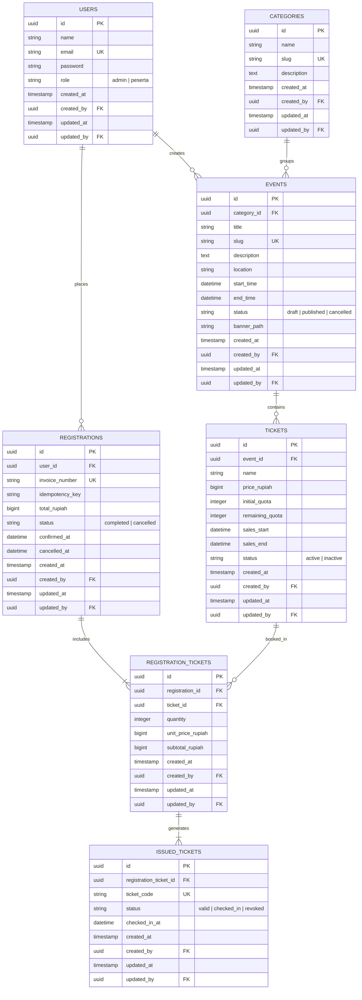

# Perancangan Database: Entity Relationship Diagram (ERD) & Kamus Data
## Sistem Manajemen Event & Tiket — Laravel 13 Modular Monolith

**Penyusun:** Muhammad Imam Panji Prasetya (`panjiprasetyaa`) — Anggota 2 (Koordinator Skema & Database)  
**Tujuan Dokumen:** Bahan resmi untuk **BAB II (Perancangan Sistem)** Laporan UTS Backend Development (DT199)  
**Standar Arsitektur:** UUID Primary Key, Foreign Key Constraints, dan Standar 5 Kolom Audit (`[AUDIT5]`) pada Seluruh Tabel Domain

---

## 1. Filosofi & Konvensi Basis Data Tim

Untuk memenuhi standar akademik perancangan basis data relasional serta rubrik penilaian UTS:
1. **Primary Key UUID:** Seluruh tabel yang dirancang kelompok menggunakan UUID versi 4 (36 karakter) sebagai Primary Key (`$table->uuid('id')->primary()`) untuk mencegah enumerasi ID secara berurutan dan mendukung arsitektur terdistribusi/modular.
2. **Standardisasi Audit Trail (`[AUDIT5]`):** Setiap tabel aplikasi memiliki lima atribut wajib:
   - `id` (UUID PK): Identitas unik entitas.
   - `created_at` (TIMESTAMP): Waktu pembuatan record.
   - `created_by` (UUID FK nullable): Merujuk ke `users.id` yang membuat record secara server-side.
   - `updated_at` (TIMESTAMP): Waktu pembaruan record terakhir.
   - `updated_by` (UUID FK nullable): Merujuk ke `users.id` yang memperbarui record terakhir.
3. **Penyimpanan Nilai Uang:** Menggunakan integer rupiah (`price_rupiah`, `total_rupiah`, `unit_price_rupiah`, `subtotal_rupiah`) untuk menghindari kesalahan pembulatan pada tipe data desimal/float.

---

## 2. Entity Relationship Diagram (ERD) — Notasi Crow's Foot

---

## 3. Matriks Relasi Antar-Tabel

| Entitas Asal | Kardinalitas | Entitas Tujuan | Jenis Relasi | Foreign Key | Penjelasan Bisnis |
|---|:---:|---|---|---|---|
| `categories` | **1 : N** | `events` | One-to-Many | `events.category_id` | Satu kategori menaungi banyak event; setiap event wajib masuk dalam satu kategori. |
| `events` | **1 : N** | `tickets` | One-to-Many | `tickets.event_id` | Satu event menyediakan banyak jenis tiket (misal: VIP, Regular, Early Bird). |
| `users` | **1 : N** | `registrations` | One-to-Many | `registrations.user_id` | Satu user peserta dapat melakukan banyak transaksi registrasi/pemesanan. |
| `registrations` | **N : M** | `tickets` | **Many-to-Many dengan Pivot** | Tabel pivot: `registration_tickets` | Satu pesanan dapat membeli beberapa jenis tiket, dan satu jenis tiket dapat dibeli dalam banyak transaksi pesanan. |
| `registration_tickets` | **1 : N** | `issued_tickets` | One-to-Many | `issued_tickets.registration_ticket_id` | Satu baris pembelian tiket dengan `quantity = n` akan menerbitkan tepat `n` tiket individual ber-kode unik. |

---

## 4. Kamus Data (Data Dictionary) Lengkap

### 4.1 Tabel: `users` (Core / Autentikasi)
Tabel utama untuk autentikasi Laravel Sanctum dan otorisasi Role-Based Access Control (RBAC).

| No | Nama Kolom | Tipe Data | Nullable | Kunci | Default | Deskripsi Bisnis |
|:--:|---|---|:---:|:---:|---|---|
| 1 | `id` | UUID (char 36) | NO | PK | — | Identifier unik pengguna |
| 2 | `name` | VARCHAR(255) | NO | — | — | Nama lengkap pengguna |
| 3 | `email` | VARCHAR(255) | NO | UNIQUE | — | Alamat surel untuk login |
| 4 | `password` | VARCHAR(255) | NO | — | — | Hash kata sandi pengguna (Bcrypt) |
| 5 | `role` | VARCHAR(50) | NO | — | `'peserta'` | Peran pengguna: `'admin'` atau `'peserta'` |
| 6 | `created_at` | TIMESTAMP | YES | — | NULL | Waktu akun didaftarkan |
| 7 | `created_by` | UUID (char 36) | YES | FK | NULL | Pembuat akun (NULL untuk registrasi mandiri) |
| 8 | `updated_at` | TIMESTAMP | YES | — | NULL | Waktu pembaruan akun terakhir |
| 9 | `updated_by` | UUID (char 36) | YES | FK | NULL | Pengguna yang memperbarui akun terakhir |

---

### 4.2 Tabel: `categories` (EventModule)
Master data kategori penyelenggaraan event (misal: Musik, Workshop, Seminar).

| No | Nama Kolom | Tipe Data | Nullable | Kunci | Default | Deskripsi Bisnis |
|:--:|---|---|:---:|:---:|---|---|
| 1 | `id` | UUID (char 36) | NO | PK | — | Identifier unik kategori |
| 2 | `name` | VARCHAR(255) | NO | — | — | Nama kategori |
| 3 | `slug` | VARCHAR(255) | NO | UNIQUE | — | URL slug unik untuk navigasi |
| 4 | `description` | TEXT | YES | — | NULL | Uraian lengkap kategori |
| 5 | `created_at` | TIMESTAMP | YES | — | NULL | Waktu pembuatan kategori |
| 6 | `created_by` | UUID (char 36) | YES | FK | NULL | Admin pembuat kategori |
| 7 | `updated_at` | TIMESTAMP | YES | — | NULL | Waktu pembaruan kategori terakhir |
| 8 | `updated_by` | UUID (char 36) | YES | FK | NULL | Admin pembaruan kategori terakhir |

---

### 4.3 Tabel: `events` (EventModule)
Master data kegiatan/acara yang diselenggarakan.

| No | Nama Kolom | Tipe Data | Nullable | Kunci | Default | Deskripsi Bisnis |
|:--:|---|---|:---:|:---:|---|---|
| 1 | `id` | UUID (char 36) | NO | PK | — | Identifier unik event |
| 2 | `category_id` | UUID (char 36) | NO | FK | — | Referensi ke `categories.id` |
| 3 | `title` | VARCHAR(255) | NO | — | — | Judul acara event |
| 4 | `slug` | VARCHAR(255) | NO | UNIQUE | — | Slug unik untuk tautan detail event |
| 5 | `description` | TEXT | YES | — | NULL | Deskripsi dan informasi acara |
| 6 | `location` | VARCHAR(255) | NO | — | — | Lokasi/venue pelaksanaan event |
| 7 | `start_time` | DATETIME | NO | — | — | Waktu mulai acara |
| 8 | `end_time` | DATETIME | NO | — | — | Waktu selesai acara (`end_time > start_time`) |
| 9 | `status` | VARCHAR(50) | NO | — | `'draft'` | Status publikasi: `'draft'`, `'published'`, `'cancelled'` |
| 10 | `banner_path` | VARCHAR(255) | YES | — | NULL | Lokasi file gambar/poster event |
| 11 | `created_at` | TIMESTAMP | YES | — | NULL | Waktu pembuatan event |
| 12 | `created_by` | UUID (char 36) | YES | FK | NULL | Admin pembuat event |
| 13 | `updated_at` | TIMESTAMP | YES | — | NULL | Waktu pembaruan event terakhir |
| 14 | `updated_by` | UUID (char 36) | YES | FK | NULL | Admin pembaruan event terakhir |

---

### 4.4 Tabel: `tickets` (TicketModule — Domain Anggota 2)
Master data tipe tiket, alokasi kuota, dan harga satuan.

| No | Nama Kolom | Tipe Data | Nullable | Kunci | Default | Deskripsi Bisnis |
|:--:|---|---|:---:|:---:|---|---|
| 1 | `id` | UUID (char 36) | NO | PK | — | Identifier unik tiket |
| 2 | `event_id` | UUID (char 36) | NO | FK | — | Referensi ke `events.id` |
| 3 | `name` | VARCHAR(255) | NO | — | — | Nama tipe tiket (VIP, Regular, dll.) |
| 4 | `price_rupiah` | BIGINT | NO | — | 0 | Harga tiket dalam satuan Rupiah integer |
| 5 | `initial_quota` | INTEGER | NO | — | 0 | Kuota total tiket yang dialokasikan |
| 6 | `remaining_quota` | INTEGER | NO | — | 0 | Sisa kuota tiket (`0 <= remaining <= initial`) |
| 7 | `sales_start` | DATETIME | YES | — | NULL | Waktu pembukaan penjualan tiket |
| 8 | `sales_end` | DATETIME | YES | — | NULL | Waktu penutupan penjualan tiket |
| 9 | `status` | VARCHAR(50) | NO | — | `'active'` | Status tiket: `'active'` atau `'inactive'` |
| 10 | `created_at` | TIMESTAMP | YES | — | NULL | Waktu pembuatan tiket |
| 11 | `created_by` | UUID (char 36) | YES | FK | NULL | Admin pembuat tiket |
| 12 | `updated_at` | TIMESTAMP | YES | — | NULL | Waktu pembaruan kuota/tiket terakhir |
| 13 | `updated_by` | UUID (char 36) | YES | FK | NULL | User yang memicu mutasi kuota terakhir |

---

### 4.5 Tabel: `registrations` (RegistrationModule)
Header transaksi pemesanan tiket oleh peserta.

| No | Nama Kolom | Tipe Data | Nullable | Kunci | Default | Deskripsi Bisnis |
|:--:|---|---|:---:|:---:|---|---|
| 1 | `id` | UUID (char 36) | NO | PK | — | Identifier unik pesanan |
| 2 | `user_id` | UUID (char 36) | NO | FK | — | Referensi ke `users.id` (pemesan) |
| 3 | `invoice_number`| VARCHAR(255) | NO | UNIQUE | — | Nomor tagihan/invoice unik (`INV-YYYYMMDD-XXXX`) |
| 4 | `idempotency_key`| VARCHAR(255) | YES | — | NULL | Mencegah double-checkout pada koneksi lambat |
| 5 | `total_rupiah` | BIGINT | NO | — | 0 | Total nominal pembayaran transaksi |
| 6 | `status` | VARCHAR(50) | NO | — | `'completed'`| Status transaksi (simulasi checkout berhasil) |
| 7 | `confirmed_at` | DATETIME | YES | — | NULL | Waktu konfirmasi checkout berhasil |
| 8 | `cancelled_at` | DATETIME | YES | — | NULL | Waktu pembatalan transaksi (jika ada) |
| 9 | `created_at` | TIMESTAMP | YES | — | NULL | Waktu checkout dibuat |
| 10 | `created_by` | UUID (char 36) | YES | FK | NULL | Peserta yang melakukan transaksi |
| 11 | `updated_at` | TIMESTAMP | YES | — | NULL | Waktu update transaksi |
| 12 | `updated_by` | UUID (char 36) | YES | FK | NULL | User yang mengupdate transaksi |

---

### 4.6 Tabel: `registration_tickets` (RegistrationModule — Tabel Pivot Many-to-Many)
Tabel perantara relasi Many-to-Many antara pesanan (`registrations`) dan tiket (`tickets`).

| No | Nama Kolom | Tipe Data | Nullable | Kunci | Default | Deskripsi Bisnis |
|:--:|---|---|:---:|:---:|---|---|
| 1 | `id` | UUID (char 36) | NO | PK | — | Identifier unik baris pivot |
| 2 | `registration_id`| UUID (char 36)| NO | FK | — | Referensi ke `registrations.id` |
| 3 | `ticket_id` | UUID (char 36) | NO | FK | — | Referensi ke `tickets.id` |
| 4 | `quantity` | INTEGER | NO | — | 1 | Jumlah tiket yang dibeli pada item ini |
| 5 | `unit_price_rupiah`| BIGINT | NO | — | 0 | **Snapshot harga** saat transaksi dilakukan |
| 6 | `subtotal_rupiah` | BIGINT | NO | — | 0 | Subtotal (`quantity * unit_price_rupiah`) |
| 7 | `created_at` | TIMESTAMP | YES | — | NULL | Waktu pencatatan pivot |
| 8 | `created_by` | UUID (char 36) | YES | FK | NULL | Aktor pemesan tiket |
| 9 | `updated_at` | TIMESTAMP | YES | — | NULL | Waktu update pivot |
| 10 | `updated_by` | UUID (char 36) | YES | FK | NULL | Aktor pengupdate pivot |

---

### 4.7 Tabel: `issued_tickets` (RegistrationModule)
Menyimpan identitas fisik 1 tiket individual yang diterbitkan beserta kode tiket unik.

| No | Nama Kolom | Tipe Data | Nullable | Kunci | Default | Deskripsi Bisnis |
|:--:|---|---|:---:|:---:|---|---|
| 1 | `id` | UUID (char 36) | NO | PK | — | Identifier unik tiket terbit |
| 2 | `registration_ticket_id`| UUID (char 36)| NO | FK | — | Referensi ke baris `registration_tickets.id` |
| 3 | `ticket_code` | VARCHAR(255) | NO | UNIQUE | — | **Kode unik tiket** (misal: `TKT-20261117-XXXX`) |
| 4 | `status` | VARCHAR(50) | NO | — | `'valid'` | Status tiket: `'valid'`, `'checked_in'`, `'revoked'` |
| 5 | `checked_in_at` | DATETIME | YES | — | NULL | Waktu check-in tiket di venue acara |
| 6 | `created_at` | TIMESTAMP | YES | — | NULL | Waktu penerbitan tiket |
| 7 | `created_by` | UUID (char 36) | YES | FK | NULL | Aktor penerbitan tiket |
| 8 | `updated_at` | TIMESTAMP | YES | — | NULL | Waktu update tiket |
| 9 | `updated_by` | UUID (char 36) | YES | FK | NULL | Aktor update tiket |
