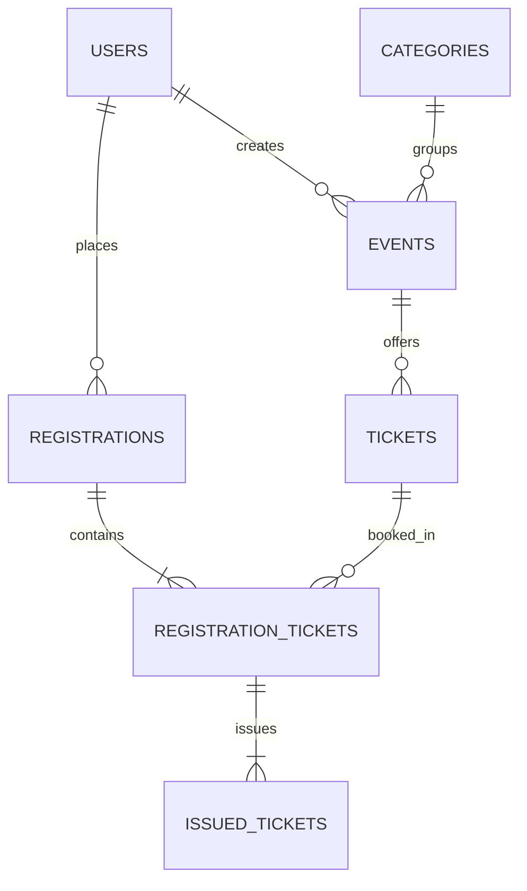

# Draf Materi Laporan UTS (BAB II & BAB III)
## Bagian Anggota 2: Perancangan ERD Database & Implementasi TicketModule

**Penulis:** Muhammad Imam Panji Prasetya (`panjiprasetyaa`) — Anggota 2  
**Mata Kuliah:** Backend Development (DT199) — Universitas Amikom Yogyakarta  
**Studi Kasus:** Sistem Manajemen Event & Tiket (Modular Monolith Laravel 13)

---

## BAB II: PERANCANGAN SISTEM (PORSI ANGGOTA 2)

### 2.2 Perancangan Basis Data (Entity Relationship Diagram)
Basis data pada sistem ini dirancang menggunakan pendekatan relasional dengan standarisasi modern, di mana setiap tabel domain menggunakan **UUID versi 4 (char 36)** sebagai *Primary Key* serta menerapkan standar 5 kolom audit (*Audit Trail*: `id`, `created_at`, `created_by`, `updated_at`, `updated_by`). Pendekatan ini menjamin integritas data, mencegah enumerasi sekuensial yang rentan dari sisi keamanan, dan memastikan setiap perubahan data tercatat aktor penanggung jawabnya (*auditability*).

Diagram ERD dengan notasi formal *Crow's Foot* digambarkan sebagai berikut:



#### Relasi Database Wajib:
1. **Relasi One-to-Many (`1 : N`):**
   - Relasi antara tabel `categories` ke tabel `events`: Satu kategori menaungi banyak kegiatan event.
   - Relasi antara tabel `events` ke tabel `tickets`: Satu acara event menyediakan banyak kategori jenis tiket (misal: VIP, Regular, Early Bird).
   - Relasi antara tabel `users` ke tabel `registrations`: Satu user peserta dapat melakukan transaksi pendaftaran berulang kali.
2. **Relasi Many-to-Many dengan Tabel Pivot (`N : M`):**
   - Relasi antara tabel `registrations` dan `tickets` dihubungkan melalui tabel pivot `registration_tickets`.
   - Tabel pivot ini tidak hanya menyimpan pasangan foreign key `registration_id` dan `ticket_id`, melainkan juga mencatat atribut pivot penting berupa `quantity` (jumlah tiket dipesan), `unit_price_rupiah` (*snapshot harga* satuan pada saat transaksi dilakukan untuk melindungi integritas nilai historis saat harga tiket master diubah di kemudian hari), dan `subtotal_rupiah`.

---

## BAB III: IMPLEMENTASI SISTEM (PORSI ANGGOTA 2)

### 3.2 Implementasi Skema Database & Migrasi Modular
Setiap modul mengelola file migrasinya secara mandiri di bawah direktori `Database/Migrations/`. Service Provider masing-masing modul memuat migrasi tersebut menggunakan pemanggilan `$this->loadMigrationsFrom(...)`.

Contoh implementasi migrasi tabel `tickets` pada `TicketModule`:
```php
Schema::create('tickets', function (Blueprint $table) {
    $table->uuid('id')->primary();
    $table->foreignUuid('event_id')->constrained('events')->cascadeOnDelete();
    $table->string('name');
    $table->unsignedBigInteger('price_rupiah')->default(0);
    $table->unsignedInteger('initial_quota')->default(0);
    $table->unsignedInteger('remaining_quota')->default(0);
    $table->dateTime('sales_start')->nullable();
    $table->dateTime('sales_end')->nullable();
    $table->string('status', 50)->default('active');

    $table->timestamps();
    $table->foreignUuid('created_by')->nullable()->constrained('users')->nullOnDelete();
    $table->foreignUuid('updated_by')->nullable()->constrained('users')->nullOnDelete();

    $table->index(['event_id', 'status']);
});
```

### 3.4 Implementasi Komunikasi Antar-Modul: `TicketInventoryContract`
Sesuai ketentuan soal nomor 1c (*Dilarang mengakses model/tabel modul lain secara langsung*), modul `RegistrationModule` tidak diperbolehkan meng-import model Eloquent `Ticket`. Seluruh interaksi pengecekan ketersediaan dan pemotongan kuota wajib melalui antarmuka **Contract (Interface)**:

```php
namespace App\Modules\TicketModule\Contracts;

interface TicketInventoryContract
{
    public function getSummary(string $ticketId): ?array;
    public function getEventTickets(string $eventId): array;
    public function reserve(string $ticketId, int $quantity): array;
    public function release(string $ticketId, int $quantity): void;
}
```

Metode `reserve()` menjamin eksekusi atomik dengan menerapkan `lockForUpdate()` pada row tiket yang bersangkutan di dalam transaksi database aktif:

```php
public function reserve(string $ticketId, int $quantity): array
{
    if (DB::transactionLevel() === 0) {
        throw new LogicException('TicketInventoryContract::reserve() wajib dijalankan di dalam DB::transaction.');
    }

    $ticket = Ticket::query()->lockForUpdate()->find($ticketId);

    if (!$ticket || $ticket->status !== 'active' || !$ticket->isOnSale()) {
        throw new TicketNotAvailableException('Tiket sedang tidak tersedia untuk penjualan.');
    }

    if ($ticket->remaining_quota < $quantity) {
        throw new TicketQuotaExceededException('Sisa kuota tiket tidak mencukupi pesanan Anda.');
    }

    $ticket->update([
        'remaining_quota' => $ticket->remaining_quota - $quantity,
        'updated_by' => Auth::id(),
    ]);

    return [
        'id' => $ticket->id,
        'event_id' => $ticket->event_id,
        'name' => $ticket->name,
        'price_rupiah' => $ticket->price_rupiah,
        'quantity' => $quantity,
    ];
}
```

### 3.5 Penanganan Kesalahan: `TicketQuotaExceededException`
Untuk memenuhi rubrik validasi & error handling, sistem menyediakan Custom Exception turunan class `Exception` yang otomatis mengembalikan respon informatif ke View Blade peserta:
```php
namespace App\Modules\TicketModule\Exceptions;

use Exception;
use Illuminate\Http\Request;

class TicketQuotaExceededException extends Exception
{
    public function render(Request $request)
    {
        if ($request->expectsJson()) {
            return response()->json(['message' => $this->getMessage()], 422);
        }

        return back()->withInput()->with('error', $this->getMessage());
    }
}
```
Ketika kuota tidak mencukupi, exception ini langsung memicu pembatalan (*rollback*) pada transaksi database yang sedang berlangsung di `CheckoutService`.
